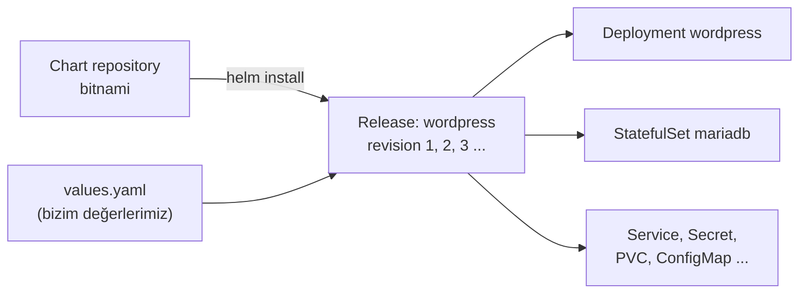

# A01 — Helm ile Hazır Chart Yönetimi: WordPress

| Profil / Araçlar | Açık Portlar |
|---|---|
| `helm` 4, `kubectl`, `bitnami/wordpress` chart `34.2.7` (WordPress + MariaDB) | 30088 (NodePort) |

## Amaç

- Hazır bir chart'ı inceleyip kendi values dosyasıyla kurmak.
- Release'i güncellemek, geçmişini görmek ve geri almak.

## Ön Koşullar

- Beginner ve Intermediate lablar tamamlanmış olmalıdır.
- Sunucuda `30088` portu Kind tarafından dinleniyor olmalıdır (`kind-cluster.yaml`).

## Mimari ve Çalışma Modeli

Helm, birbirine bağlı Kubernetes nesnelerini tek bir paket olarak kurar ve sürümler:



| Kavram | Anlamı |
|---|---|
| Chart | Kubernetes nesnelerinin şablonlarından oluşan paket |
| Values | Şablonlara verilen değerler; chart'ın varsayılanlarının üzerine yazılır |
| Release | Chart'ın cluster'a belirli bir adla kurulmuş örneği |
| Revision | Release'in her `install`, `upgrade` veya `rollback` sonrası aldığı sıra numarası |

Değerlerin önceliği düşükten yükseğe: chart'ın `values.yaml` dosyası → `-f dosya.yaml` (sırayla) → `--set anahtar=değer`.

## Adım Adım Uygulama Rehberi

### 1. Repository ve Chart Arama

```bash
cd ~/k8s-labs/advanced/lab-a01-helm-wordpress
```

```bash
helm version --short
```

```bash
helm repo add bitnami https://charts.bitnami.com/bitnami
```

```bash
helm repo update bitnami
```

```bash
helm search repo bitnami/wordpress --versions | head -5
```

`CHART VERSION` chart paketinin, `APP VERSION` içindeki uygulamanın sürümüdür. Bu labda chart sürümü sabittir: `34.2.7`.

### 2. Chart'ın İçine Bakma

Chart'ı kurmadan indirip açın:

```bash
helm pull bitnami/wordpress --version 34.2.7 --untar --untardir chart
```

```bash
ls chart/wordpress chart/wordpress/templates | head -30
```

`Chart.yaml` meta bilgileri ve bağımlılıkları (MariaDB alt chart'ı), `values.yaml` değiştirilebilir bütün ayarları, `templates/` Kubernetes nesnelerinin şablonlarını içerir:

```bash
grep -A3 '^dependencies' chart/wordpress/Chart.yaml
```

Değiştirilebilecek bir ayarı aramak için:

```bash
helm show values bitnami/wordpress --version 34.2.7 | grep -n -A4 '^service:'
```

### 3. Kendi Değerlerimizle Kurulum

Yalnızca değiştirmek istediğimiz değerleri yazarız:

```bash
cat starter/values.yaml
```

Kurulumdan önce oluşacak nesneleri görmek için şablonu cluster'a göndermeden üretin:

```bash
helm template wordpress bitnami/wordpress --version 34.2.7 -f starter/values.yaml | grep '^kind:' | sort | uniq -c
```

Kurun. `--wait`, bütün Pod'lar hazır olana kadar bekler; ilk kurulum birkaç dakika sürebilir:

```bash
helm install wordpress bitnami/wordpress --version 34.2.7 \
  --namespace a01-helm --create-namespace \
  -f starter/values.yaml \
  --wait --timeout 10m
```

```bash
helm list -n a01-helm
```

```bash
kubectl get pods,pvc,service -n a01-helm
```

### 4. Uygulamaya Erişim

```bash
curl -s -o /dev/null -w '%{http_code}\n' --retry 5 --retry-all-errors --retry-delay 3 http://127.0.0.1:30088/
```

```bash
curl -s http://127.0.0.1:30088/ | grep -o '<title>[^<]*</title>'
```

Tarayıcıdan açacağınız adresler; yönetim paneline `admin` / `DevOps2026!` ile girin:

```bash
echo "Site:  http://$(curl -s ifconfig.me):30088"
echo "Panel: http://$(curl -s ifconfig.me):30088/wp-admin"
```

Release'in kullandığı değerler ve Helm'in cluster'a gönderdiği manifestler:

```bash
helm get values wordpress -n a01-helm
```

```bash
helm get manifest wordpress -n a01-helm | grep '^kind:' | sort | uniq -c
```

### 5. Release Güncelleme

İkinci values dosyası Pod'lara etiket ve kaynak ayarı ekler. Sonraki `-f` dosyası öncekinin üzerine yazar:

```bash
cat starter/values-v2.yaml
```

```bash
helm upgrade wordpress bitnami/wordpress --version 34.2.7 \
  --namespace a01-helm \
  -f starter/values.yaml -f starter/values-v2.yaml \
  --wait --timeout 10m
```

```bash
helm history wordpress -n a01-helm
```

```bash
kubectl get pods -n a01-helm -l app.kubernetes.io/name=wordpress -L surum
```

Her revizyonun değerleri ayrı saklanır:

```bash
helm get values wordpress -n a01-helm --revision 2 | grep -A1 podLabels
```

`wordpressBlogName` gibi bazı ayarlar uygulama tarafından yalnızca ilk kurulumda veritabanına yazılır; sonradan `upgrade` ile değiştirmek çalışan siteyi değiştirmez. Bir değerin upgrade ile etkili olup olmadığını chart'ın belgelerinden kontrol edin.

### 6. Önceki Sürüme Dönme

```bash
helm rollback wordpress 1 -n a01-helm --wait --timeout 10m
```

Geri dönüş yeni bir revizyon olarak kaydedilir:

```bash
helm history wordpress -n a01-helm
```

```bash
kubectl get pods -n a01-helm -l app.kubernetes.io/name=wordpress -L surum
```

`SURUM` sütunu boşaldı; release 1. revizyonun değerleriyle çalışıyor.

## Temizlik

Release'i kaldırın:

```bash
helm uninstall wordpress -n a01-helm
```

`helm uninstall`, StatefulSet'in oluşturduğu veritabanı diskini veri güvenliği için silmez:

```bash
kubectl get pvc -n a01-helm
```

Namespace'i silmek kalan diski de siler:

```bash
kubectl delete namespace a01-helm
```

```bash
rm -rf chart
```
