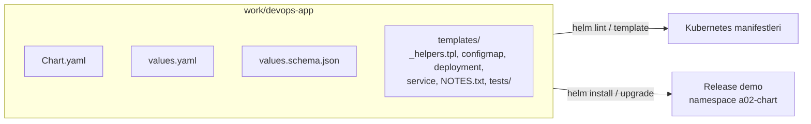

# A02 — Sıfırdan Helm Chart Yazma

| Profil / Araçlar | Açık Portlar |
|---|---|
| `helm` 4, `kubectl`, `docker`, `kind`, `devops-app` 1.0 ve 2.0 | — |

## Amaç

- `devops-app` için kendi Helm chart'ını yazmak.
- Chart'ı cluster'a göndermeden doğrulamak.
- Kurmak, güncellemek, test etmek ve paketlemek.

## Ön Koşullar

- A01 tamamlanmış olmalıdır (Helm kavramları).

## Mimari ve Çalışma Modeli



| Dosya | Görevi |
|---|---|
| `Chart.yaml` | Chart adı, chart sürümü (`version`) ve uygulama sürümü (`appVersion`) |
| `values.yaml` | Şablonların varsayılan değerleri |
| `values.schema.json` | Değerlerin tip ve aralık kontrolü; hatalı değer manifest üretilmeden reddedilir |
| `templates/_helpers.tpl` | Tekrar kullanılan ad ve label şablonları; kendi başına nesne üretmez |
| `templates/*.yaml` | Kubernetes nesnelerinin şablonları |
| `templates/NOTES.txt` | Kurulumdan sonra ekrana yazılan kullanım notu |
| `templates/tests/` | `helm test` ile çalışan test Pod'ları |

Şablon içinde en sık kullanılan nesneler: `.Values` (değerler), `.Chart` (Chart.yaml), `.Release` (release adı, namespace, revizyon). `version` chart değişince, `appVersion` uygulama sürümü değişince artırılır.

## Adım Adım Uygulama Rehberi

### 1. Uygulama İmajları

```bash
cd ~/k8s-labs/advanced/lab-a02-helm-chart-from-scratch
```

```bash
docker build -t devops-app:1.0 ~/k8s-labs/app/devops-app
```

```bash
docker build --build-arg APP_VERSION=2.0 -t devops-app:2.0 ~/k8s-labs/app/devops-app
```

```bash
kind load docker-image devops-app:1.0 devops-app:2.0 --name k8s-labs
```

### 2. Chart İskeleti

`helm create` örnek bir chart üretir. Yapıyı görün, ardından şablonları kendiniz yazmak için `templates/` dizinini boşaltın:

```bash
mkdir -p work && helm create work/devops-app
```

```bash
find work/devops-app -type f | sort
```

```bash
rm -rf work/devops-app/templates && mkdir -p work/devops-app/templates/tests
```

### 3. Chart.yaml ve values.yaml

```bash
cat > work/devops-app/Chart.yaml <<'EOF'
apiVersion: v2
name: devops-app
description: devops-app icin egitim amacli Helm chart
type: application
version: 0.1.0
appVersion: "1.0"
EOF
```

```bash
cat > work/devops-app/values.yaml <<'EOF'
replicaCount: 2

image:
  repository: devops-app
  tag: ""                 # bos birakilirsa Chart.yaml icindeki appVersion kullanilir
  pullPolicy: IfNotPresent

app:
  message: "Helm ile yonetilen devops-app"

service:
  type: ClusterIP
  port: 80

resources:
  requests:
    cpu: 50m
    memory: 64Mi
  limits:
    memory: 128Mi
EOF
```

### 4. Values Şeması

```bash
cat > work/devops-app/values.schema.json <<'EOF'
{
  "$schema": "https://json-schema.org/draft-07/schema#",
  "type": "object",
  "required": ["replicaCount", "image", "app", "service"],
  "properties": {
    "replicaCount": { "type": "integer", "minimum": 1, "maximum": 10 },
    "image": {
      "type": "object",
      "required": ["repository", "pullPolicy"],
      "properties": {
        "repository": { "type": "string", "minLength": 1 },
        "tag": { "type": "string" },
        "pullPolicy": { "type": "string", "enum": ["Always", "IfNotPresent", "Never"] }
      }
    },
    "service": {
      "type": "object",
      "properties": {
        "type": { "type": "string", "enum": ["ClusterIP", "NodePort"] },
        "port": { "type": "integer", "minimum": 1, "maximum": 65535 }
      }
    }
  }
}
EOF
```

### 5. Ortak Yardımcılar: _helpers.tpl

```bash
cat > work/devops-app/templates/_helpers.tpl <<'EOF'
{{/* Kaynak adi: release adi + chart adi, en fazla 63 karakter */}}
{{- define "devops-app.fullname" -}}
{{- printf "%s-%s" .Release.Name .Chart.Name | trunc 63 | trimSuffix "-" }}
{{- end }}

{{/* Selector'da kullanilan, hic degismeyen etiketler */}}
{{- define "devops-app.selectorLabels" -}}
app.kubernetes.io/name: {{ .Chart.Name }}
app.kubernetes.io/instance: {{ .Release.Name }}
{{- end }}

{{/* Tum nesnelere eklenen etiketler */}}
{{- define "devops-app.labels" -}}
{{ include "devops-app.selectorLabels" . }}
app.kubernetes.io/version: {{ .Chart.AppVersion | quote }}
app.kubernetes.io/managed-by: {{ .Release.Service }}
helm.sh/chart: {{ printf "%s-%s" .Chart.Name .Chart.Version }}
{{- end }}
EOF
```

`define` adlandırılmış bir şablon tanımlar, `include` onu çağırır. `trunc 63`, Kubernetes ad sınırını aşmamak içindir.

### 6. Nesne Şablonları

ConfigMap:

```bash
cat > work/devops-app/templates/configmap.yaml <<'EOF'
apiVersion: v1
kind: ConfigMap
metadata:
  name: {{ include "devops-app.fullname" . }}
  labels:
    {{- include "devops-app.labels" . | nindent 4 }}
data:
  APP_MESSAGE: {{ .Values.app.message | quote }}
EOF
```

Deployment. `checksum/config` anotasyonu, ConfigMap değişince Pod'ların yeniden başlamasını sağlar:

```bash
cat > work/devops-app/templates/deployment.yaml <<'EOF'
apiVersion: apps/v1
kind: Deployment
metadata:
  name: {{ include "devops-app.fullname" . }}
  labels:
    {{- include "devops-app.labels" . | nindent 4 }}
spec:
  replicas: {{ .Values.replicaCount }}
  selector:
    matchLabels:
      {{- include "devops-app.selectorLabels" . | nindent 6 }}
  template:
    metadata:
      labels:
        {{- include "devops-app.selectorLabels" . | nindent 8 }}
      annotations:
        checksum/config: {{ include (print $.Template.BasePath "/configmap.yaml") . | sha256sum }}
    spec:
      containers:
        - name: app
          image: "{{ .Values.image.repository }}:{{ .Values.image.tag | default .Chart.AppVersion }}"
          imagePullPolicy: {{ .Values.image.pullPolicy }}
          ports:
            - name: http
              containerPort: 8080
          envFrom:
            - configMapRef:
                name: {{ include "devops-app.fullname" . }}
          readinessProbe:
            httpGet:
              path: /healthz
              port: http
          lifecycle:
            preStop:              # kapanirken Service'ten cikarilmayi bekle (I02)
              exec:
                command: ["sleep", "5"]
          {{- with .Values.resources }}
          resources:
            {{- toYaml . | nindent 12 }}
          {{- end }}
EOF
```

`preStop` beklemesi, güncelleme sırasında kapanan Pod'un trafik almayı bitirmesini sağlar (I02). `with` bloğu, değer boşsa alanı hiç üretmez. `toYaml` iç içe değeri YAML'a çevirir, `nindent` doğru girintiye yerleştirir.

Service:

```bash
cat > work/devops-app/templates/service.yaml <<'EOF'
apiVersion: v1
kind: Service
metadata:
  name: {{ include "devops-app.fullname" . }}
  labels:
    {{- include "devops-app.labels" . | nindent 4 }}
spec:
  type: {{ .Values.service.type }}
  selector:
    {{- include "devops-app.selectorLabels" . | nindent 4 }}
  ports:
    - name: http
      port: {{ .Values.service.port }}
      targetPort: http
EOF
```

Kurulum notu ve test Pod'u:

```bash
cat > work/devops-app/templates/NOTES.txt <<'EOF'
{{ .Release.Name }} kuruldu (revizyon {{ .Release.Revision }}, uygulama {{ .Values.image.tag | default .Chart.AppVersion }}).
Test etmek icin: helm test {{ .Release.Name }} -n {{ .Release.Namespace }}
EOF
```

```bash
cat > work/devops-app/templates/tests/test-connection.yaml <<'EOF'
apiVersion: v1
kind: Pod
metadata:
  name: {{ include "devops-app.fullname" . }}-test
  annotations:
    "helm.sh/hook": test
    "helm.sh/hook-delete-policy": before-hook-creation
spec:
  restartPolicy: Never
  containers:
    - name: wget
      image: busybox:1.37
      command: ["wget", "-qO-", "http://{{ include "devops-app.fullname" . }}:{{ .Values.service.port }}/healthz"]
EOF
```

### 7. Cluster'a Göndermeden Doğrulama

Yapı ve şema kontrolü:

```bash
helm lint work/devops-app
```

Şema hatalı değeri reddeder. Bu hata bilinçli olarak üretilir:

```bash
helm lint work/devops-app --set replicaCount=0 || echo "sema hatali degeri reddetti"
```

Şablonların ürettiği manifestler:

```bash
helm template demo work/devops-app | grep -E '^kind:|image:|replicas:'
```

Değer değiştirince çıktı da değişir:

```bash
helm template demo work/devops-app --set replicaCount=3 --set image.tag=2.0 | grep -E 'image:|replicas:'
```

### 8. Kurulum

```bash
helm install demo work/devops-app --namespace a02-chart --create-namespace --wait --timeout 3m
```

```bash
helm list -n a02-chart
```

```bash
kubectl get all,configmap -n a02-chart -l app.kubernetes.io/instance=demo
```

Uygulamayı cluster içinden sorgulamak için bir test istemcisi açın:

```bash
kubectl run client -n a02-chart --image=busybox:1.37 -- sleep 3600
```

```bash
kubectl wait --for=condition=Ready pod/client -n a02-chart --timeout=120s
```

```bash
kubectl exec client -n a02-chart -- wget -qO- http://demo-devops-app/config; echo
```

### 9. Helm Test

```bash
helm test demo -n a02-chart
```

### 10. Yeni Sürüm: Chart ve Uygulama Güncelleme

Chart'ın yeni sürümü uygulamanın 2.0 sürümünü kullanır:

```bash
sed -i 's/^version: 0.1.0/version: 0.2.0/; s/^appVersion: "1.0"/appVersion: "2.0"/' work/devops-app/Chart.yaml
```

```bash
helm upgrade demo work/devops-app -n a02-chart --set app.message="Surum 2 yayinda" --wait --timeout 3m
```

```bash
helm history demo -n a02-chart
```

```bash
kubectl exec client -n a02-chart -- wget -qO- http://demo-devops-app/healthz; echo
```

ConfigMap değiştiği için `checksum/config` anotasyonu değişti ve Pod'lar yeni mesajla yeniden başladı:

```bash
kubectl exec client -n a02-chart -- wget -qO- http://demo-devops-app/config; echo
```

### 11. Geri Alma

```bash
helm rollback demo 1 -n a02-chart --wait --timeout 3m
```

```bash
helm history demo -n a02-chart
```

### 12. Paketleme

Chart'ı dağıtılabilir bir arşive dönüştürün:

```bash
helm package work/devops-app --destination work
```

```bash
helm show chart work/devops-app-0.2.0.tgz
```

Bu `.tgz` dosyası bir Helm repository'ye veya OCI uyumlu bir registry'ye (`helm push`) gönderilip başka cluster'larda `helm install` ile kurulabilir.

## Temizlik

```bash
helm uninstall demo -n a02-chart
```

```bash
kubectl delete namespace a02-chart
```

```bash
rm -rf work
```
