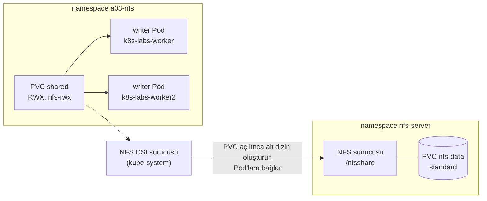

# A03 — NFS ile Paylaşımlı Depolama (ReadWriteMany)

| Profil / Araçlar | Açık Portlar |
|---|---|
| `kubectl`, `helm`, NFS CSI sürücüsü chart `4.13.6`, `itsthenetwork/nfs-server-alpine:12`, `busybox:1.37` | — |

## Amaç

- NFS CSI sürücüsüyle ReadWriteMany depolama kurmak.
- İki node'dan aynı diske yazmak.
- Kaynakları doğru sırayla kaldırmak.

## Ön Koşullar

- B08 tamamlanmış olmalıdır (PV, PVC, StorageClass).
- Cluster'da iki worker node bulunmalıdır.

## Mimari ve Çalışma Modeli

Kind'in `standard` StorageClass'ı veriyi tek bir node'un diskine yazar (`ReadWriteOnce`); o diski kullanan Pod'lar aynı node'da çalışmak zorundadır. Ağ üzerinden paylaşılan bir dosya sistemi (NFS) ise birçok node'a aynı anda bağlanabilir.



| Erişim modu | Anlamı | Örnek |
|---|---|---|
| `ReadWriteOnce` (RWO) | Tek node okuyup yazar | Kind `standard`, bulut blok diskleri |
| `ReadWriteMany` (RWX) | Birçok node aynı anda okuyup yazar | NFS, CephFS, bulut dosya servisleri |
| `ReadOnlyMany` (ROX) | Birçok node yalnızca okur | Paylaşılan statik içerik |

**CSI (Container Storage Interface)**, depolama sürücülerinin Kubernetes'e takılmasını sağlayan standarttır. NFS CSI sürücüsü, NFS bağlama işlemini kendi container'ında yapar; node'lara ayrıca NFS paketi kurmak gerekmez.

## Adım Adım Uygulama Rehberi

### 1. NFS Sunucusu

```bash
cd ~/k8s-labs/advanced/lab-a03-nfs-rwx
```

NFS sunucusu, onu kullanan uygulamalardan ayrı bir namespace'te çalışır. Böylece uygulamalar silinirken sunucu ayakta kalır:

```bash
kubectl create namespace nfs-server
```

```bash
cat starter/nfs-server.yaml
```

```bash
kubectl apply -f starter/nfs-server.yaml -n nfs-server
```

```bash
kubectl rollout status deployment/nfs-server -n nfs-server --timeout=180s
```

```bash
kubectl logs deployment/nfs-server -n nfs-server | tail -3
```

### 2. NFS CSI Sürücüsü

```bash
helm repo add csi-driver-nfs https://raw.githubusercontent.com/kubernetes-csi/csi-driver-nfs/master/charts
```

```bash
helm repo update csi-driver-nfs
```

```bash
helm upgrade --install csi-driver-nfs csi-driver-nfs/csi-driver-nfs --version 4.13.6 \
  --namespace kube-system --wait --timeout 5m
```

Sürücünün controller'ı ve her node'da çalışan bileşeni:

```bash
kubectl get pods -n kube-system -l app.kubernetes.io/instance=csi-driver-nfs -o wide
```

```bash
kubectl get csidriver nfs.csi.k8s.io
```

### 3. StorageClass

```bash
cat starter/storageclass.yaml
```

```bash
kubectl apply -f starter/storageclass.yaml
```

```bash
kubectl get storageclass
```

### 4. RWX PVC ve İki Node'dan Yazma

```bash
kubectl create namespace a03-nfs
```

```bash
kubectl apply -f starter/shared-pvc.yaml -n a03-nfs
```

```bash
kubectl wait --for=jsonpath='{.status.phase}'=Bound pvc/shared -n a03-nfs --timeout=120s
```

```bash
kubectl get pvc shared -n a03-nfs
```

Sürücü, NFS paylaşımında bu PVC için bir alt dizin oluşturdu:

```bash
kubectl exec deployment/nfs-server -n nfs-server -- ls /nfsshare
```

İki yazıcı Pod, anti-affinity nedeniyle farklı node'lara yerleşir. Her biri ortak diskte kendi node'unun adını taşıyan dosyaya üç saniyede bir satır ekler:

```bash
cat starter/writers.yaml
```

```bash
kubectl apply -f starter/writers.yaml -n a03-nfs
```

```bash
kubectl rollout status deployment/writer -n a03-nfs --timeout=180s
```

```bash
kubectl get pods -n a03-nfs -o wide
```

Birkaç saniye bekleyip ortak diski Pod'lardan biriyle okuyun. Bu Pod, diğer node'daki Pod'un yazdığı dosyayı da görür:

```bash
sleep 10; kubectl exec deployment/writer -n a03-nfs -- ls /data
```

```bash
kubectl exec deployment/writer -n a03-nfs -- sh -c 'tail -n 2 /data/*.log'
```

Aynı dosyalar NFS sunucusunun diskinde durur:

```bash
kubectl exec deployment/nfs-server -n nfs-server -- sh -c 'ls /nfsshare/*/'
```

Paylaşımlı diskte aynı dosyaya iki node'dan aynı anda ekleme yapmak güvenli değildir; satırlar birbirinin üzerine yazılabilir. Birden çok yazıcı ya ayrı dosyalar kullanır ya da veritabanı gibi eşzamanlı yazmayı yöneten bir sistem tercih edilir.

### 5. Pod Silinince Veri Kalır

```bash
kubectl delete pod -n a03-nfs -l app=writer
```

```bash
kubectl rollout status deployment/writer -n a03-nfs --timeout=180s
```

Yeni Pod'lar aynı dosyalara eklemeye devam eder; eski satırlar korunur:

```bash
sleep 5; kubectl exec deployment/writer -n a03-nfs -- sh -c 'wc -l /data/*.log'
```

## Temizlik

Sıra önemlidir. PVC silinince sürücü, NFS sunucusundaki dizini siler; bunun için sunucunun hâlâ çalışıyor olması gerekir. Önce uygulamayı ve PVC'yi silin, işlemin bitmesini bekleyin:

```bash
kubectl delete namespace a03-nfs --wait=true
```

PVC'ye ait PV de silinmiş ve NFS sunucusundaki dizin kaldırılmış olmalıdır:

```bash
kubectl get pv | grep -c nfs-rwx || true
```

```bash
kubectl exec deployment/nfs-server -n nfs-server -- ls /nfsshare
```

Ardından StorageClass'ı, sunucuyu ve sürücüyü kaldırın:

```bash
kubectl delete storageclass nfs-rwx
```

```bash
kubectl delete namespace nfs-server --wait=true
```

```bash
helm uninstall csi-driver-nfs -n kube-system
```

Sunucu, PVC'leri silinmeden kaldırılırsa sürücü dizinleri silemez; PVC'ler ve onları kullanan Pod'lar silinemeden `Terminating` durumunda kalır.
