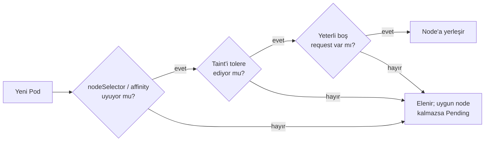
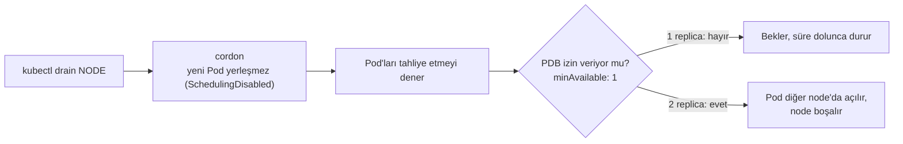

# A04 — Scheduling ve Node Bakımı

| Profil / Araçlar | Açık Portlar |
|---|---|
| `kubectl`, `nginx:1.30-alpine` | — |

## Amaç

- nodeSelector, anti-affinity ve taint ile Pod yerleşimini yönetmek.
- Node'u cordon ve drain ile bakıma almak.
- PodDisruptionBudget ile bakımı güvenli yapmak.

## Ön Koşullar

- B10 ve I03 tamamlanmış olmalıdır (`Pending` teşhisi, requests).
- Cluster'da iki worker node bulunmalıdır.

## Mimari ve Çalışma Modeli

Scheduler yeni bir Pod için önce uygun olmayan node'ları eler, sonra kalanlar arasından seçim yapar:



| Araç | Kim tanımlar | Etkisi |
|---|---|---|
| `nodeSelector` | Pod | "Yalnızca şu etiketli node'lara git" |
| Pod anti-affinity | Pod | "Benzer Pod'ların bulunduğu node'dan uzak dur" |
| Taint | Node | "Toleration taşımayan Pod buraya gelmesin" |
| Toleration | Pod | "Bu taint'e rağmen gelebilirim" (gitmek zorunda değil) |
| `cordon` | Yönetici | Node'a yeni Pod yerleşmesini durdurur |
| `drain` | Yönetici | Node'daki Pod'ları tahliye eder (cordon + eviction) |
| PodDisruptionBudget | Uygulama sahibi | Tahliye sırasında en az kaç replica'nın çalışır kalacağı |

## Adım Adım Uygulama Rehberi

### 1. Node'lar ve Hedef Worker

```bash
cd ~/k8s-labs/advanced/lab-a04-scheduling-node-maintenance
```

```bash
kubectl create namespace a04-scheduling
```

```bash
kubectl get nodes -L kubernetes.io/hostname
```

Control-plane node'unda bir taint vardır; sıradan Pod'lar oraya yerleşmez:

```bash
kubectl describe node k8s-labs-control-plane | grep Taints
```

İlk worker'ı hedef seçin:

```bash
export TARGET_NODE=k8s-labs-worker
```

### 2. nodeSelector

Hedef node'a etiket ekleyin:

```bash
kubectl label node "$TARGET_NODE" disk=ssd
```

```bash
kubectl get nodes -L disk
```

```bash
kubectl apply -f starter/ssd-app.yaml -n a04-scheduling
```

```bash
kubectl rollout status deployment/ssd-app -n a04-scheduling --timeout=120s
```

İki replica da etiketli node'da:

```bash
kubectl get pods -n a04-scheduling -l app=ssd-app -o wide
```

### 3. Pod Anti-affinity ile Yayma

```bash
cat starter/spread-app.yaml
```

```bash
kubectl apply -f starter/spread-app.yaml -n a04-scheduling
```

```bash
kubectl rollout status deployment/spread-app -n a04-scheduling --timeout=120s
```

Replica'lar farklı node'larda; bir node arızalansa bile uygulama çalışmaya devam eder:

```bash
kubectl get pods -n a04-scheduling -l app=spread-app -o wide
```

Üçüncü replica'yı isteyin. Uygun üçüncü bir worker yok:

```bash
kubectl scale deployment/spread-app --replicas=3 -n a04-scheduling
```

```bash
sleep 5; kubectl get pods -n a04-scheduling -l app=spread-app --field-selector=status.phase=Pending
```

Scheduler'ın neden yerleştiremediği olaylarda yazar:

```bash
kubectl get events -n a04-scheduling --field-selector reason=FailedScheduling -o custom-columns=MESAJ:.message --no-headers | tail -1
```

Mesajda iki worker için `didn't match pod anti-affinity rules`, control-plane için `untolerated taint` görünür.

```bash
kubectl scale deployment/spread-app --replicas=2 -n a04-scheduling
```

### 4. Taint ve Toleration

Hedef node'u eğitim iş yüklerine ayırın:

```bash
kubectl taint node "$TARGET_NODE" dedicated=egitim:NoSchedule
```

`NoSchedule`, çalışan Pod'ları etkilemez; yalnızca yeni Pod'ları engeller. `ssd-app`'i büyütün; yeni replica etiketli tek node'a gidemez:

```bash
kubectl scale deployment/ssd-app --replicas=3 -n a04-scheduling
```

```bash
sleep 5; kubectl get pods -n a04-scheduling -l app=ssd-app
```

```bash
sleep 2; kubectl get events -n a04-scheduling --field-selector reason=FailedScheduling -o custom-columns=MESAJ:.message --no-headers | tail -1
```

Etiketli tek node taint'li olduğu için mesajda `untolerated taint` görünür.

Toleration taşıyan uygulama aynı node'a yerleşebilir:

```bash
kubectl apply -f starter/tolerated-app.yaml -n a04-scheduling
```

```bash
kubectl rollout status deployment/tolerated-app -n a04-scheduling --timeout=120s
```

```bash
kubectl get pods -n a04-scheduling -l app=tolerated-app -o wide
```

Taint'i kaldırın; bekleyen replica yerleşir:

```bash
kubectl taint node "$TARGET_NODE" dedicated=egitim:NoSchedule-
```

```bash
kubectl rollout status deployment/ssd-app -n a04-scheduling --timeout=120s
```

Bu bölümün uygulamalarını silin:

```bash
kubectl delete deployment ssd-app spread-app tolerated-app -n a04-scheduling
```

### 5. Bakım: cordon, drain ve PodDisruptionBudget



`drain` node'u önce kapatır (cordon), sonra üzerindeki Pod'ları çıkarır. PodDisruptionBudget (PDB) "aynı anda en az kaç replica çalışsın" kuralıdır; tahliye bu kuralı bozacaksa reddedilir.

Tek replica'lı kritik bir uygulama ve "en az 1 replica çalışsın" diyen bütçe:

```bash
cat starter/critical-app.yaml
```

```bash
kubectl apply -f starter/critical-app.yaml -n a04-scheduling
```

```bash
kubectl rollout status deployment/critical-app -n a04-scheduling --timeout=120s
```

Uygulamanın çalıştığı node'u bakıma alın:

```bash
export MAINT_NODE=$(kubectl get pod -n a04-scheduling -l app=critical-app -o jsonpath='{.items[0].spec.nodeName}')
echo "$MAINT_NODE"
```

```bash
kubectl get pdb critical-app -n a04-scheduling
```

`ALLOWED DISRUPTIONS` sütunu `0`: tek replica tahliye edilirse bütçe bozulur. Drain'i deneyin; komut tahliyeyi reddedilen Pod'da bekler ve süre dolunca durur:

```bash
kubectl drain "$MAINT_NODE" --ignore-daemonsets --delete-emptydir-data --timeout=30s || echo "drain PDB nedeniyle tamamlanamadi"
```

Node `SchedulingDisabled` durumunda kaldı; kritik Pod hâlâ çalışıyor:

```bash
kubectl get node "$MAINT_NODE"
```

Bakımı güvenle yapabilmek için ikinci bir replica açın. Cordon edilmiş node'a yerleşemeyeceği için diğer worker'a gider:

```bash
kubectl scale deployment/critical-app --replicas=2 -n a04-scheduling
```

```bash
kubectl rollout status deployment/critical-app -n a04-scheduling --timeout=120s
```

Artık bir replica tahliye edilebilir:

```bash
kubectl drain "$MAINT_NODE" --ignore-daemonsets --delete-emptydir-data --timeout=120s
```

```bash
kubectl get pods -n a04-scheduling -o wide
```

Bakım bitti; node'u tekrar kullanıma açın:

```bash
kubectl uncordon "$MAINT_NODE"
```

## Temizlik

```bash
kubectl delete namespace a04-scheduling
```

Node etiketini ve olası taint ile cordon durumunu temizleyin:

```bash
kubectl label node "$TARGET_NODE" disk-
```

```bash
kubectl taint node "$TARGET_NODE" dedicated=egitim:NoSchedule- 2>/dev/null || true
```

```bash
kubectl uncordon k8s-labs-worker k8s-labs-worker2
```
