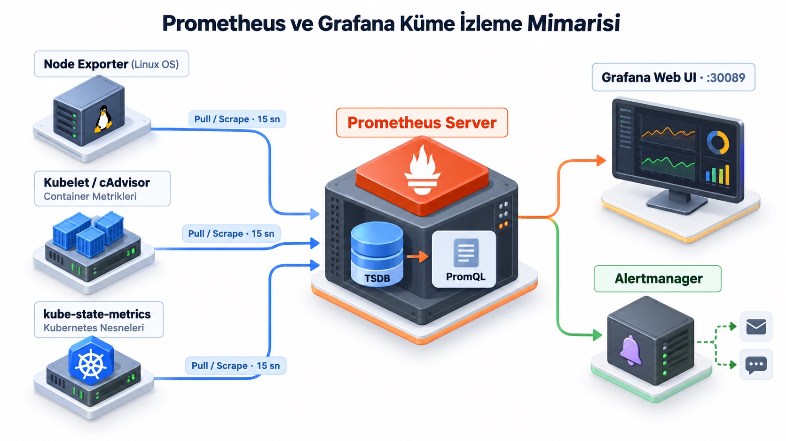

# A05 — Prometheus ve Grafana ile İzleme

| Profil / Araçlar | Açık Portlar |
|---|---|
| `helm`, `kubectl`, `jq`, `kube-prometheus-stack` chart `93.3.0`, `devops-app` | 13000 (Grafana), 19090 (Prometheus); ikisi de yalnızca `127.0.0.1` |

## Amaç

- Prometheus ve Grafana'yı tek chart ile kurmak.
- Uygulama metriklerini ServiceMonitor ile toplamak.
- Alarm kuralı yazıp alarmı canlı görmek.

## Ön Koşullar

- I05 tamamlanmış olmalıdır (requests, HPA metrikleri).
- Cluster `kind-cluster.yaml` ile oluşturulmuş olmalıdır: Grafana'nın NodePort'u `30089` sunucuda `127.0.0.1:13000`'e, Prometheus'un `30090` portu `127.0.0.1:19090`'a eşlenir.
- Sunucudaki Edge Nginx `https://<sunucu-adı>-grafana.devopsatolyesi.com` adresini `13000`'e iletir.

## Mimari ve Çalışma Modeli

{width=60%}

Prometheus hedeflerinden metrikleri belirli aralıklarla kendisi çeker (pull) ve zaman serisi olarak saklar. Alarm kurallarını değerlendirir, tetiklenen alarmları Alertmanager'a gönderir. Grafana, Prometheus'u veri kaynağı olarak kullanıp panolar çizer.

| Bileşen | Topladığı bilgi |
|---|---|
| node-exporter (DaemonSet) | Node'ların CPU, bellek, disk ve ağ kullanımı |
| kubelet / cAdvisor | Container başına CPU ve bellek |
| kube-state-metrics | Kubernetes nesnelerinin durumu: Pod fazı, yeniden başlatma sayısı, istenen replica sayısı |
| ServiceMonitor | "Bu Service'in arkasındaki Pod'lardan metrik topla" kuralı |
| PrometheusRule | PromQL ile yazılmış alarm kuralları |

Grafana'ya tarayıcıdan `https://<sunucu-adı>-grafana.devopsatolyesi.com` ile girilir. Prometheus arayüzü için alan adı tanımlı değilse kendi bilgisayarınızda SSH tüneli açın ve `http://localhost:19090` adresini kullanın. `-N` sunucuda shell açmaz, `-f` tüneli arka plana alır:

```text
ssh -fN -L 19090:127.0.0.1:19090 student@SUNUCU_IP
```

## Adım Adım Uygulama Rehberi

### 1. Kurulum

```bash
cd ~/k8s-labs/advanced/lab-a05-prometheus-grafana
```

```bash
kubectl create namespace monitoring
```

Grafana yönetici bilgisi Secret'tan okunur:

```bash
kubectl apply -f starter/grafana-admin-secret.yaml -n monitoring
```

```bash
cat starter/monitoring-values.yaml
```

```bash
helm repo add prometheus-community https://prometheus-community.github.io/helm-charts
```

```bash
helm repo update prometheus-community
```

```bash
helm upgrade --install monitoring prometheus-community/kube-prometheus-stack \
  --version 93.3.0 \
  --namespace monitoring \
  -f starter/monitoring-values.yaml \
  --wait --timeout 10m
```

```bash
kubectl get pods -n monitoring
```

Node-exporter her node'da bir Pod çalıştıran bir DaemonSet'tir:

```bash
kubectl get daemonset -n monitoring
```

### 2. Prometheus Hedefleri

Prometheus'un API'si arayüzdeki bilgilerin aynısını verir. Hedefler, iş (`job`) adına göre gruplanmış sayıları ve durumlarıyla (`up`):

```bash
timeout 120 sh -c 'until curl -sf http://127.0.0.1:19090/-/ready >/dev/null; do sleep 5; done'; curl -s http://127.0.0.1:19090/api/v1/targets | jq -r '.data.activeTargets[] | .labels.job + " " + .health' | sort | uniq -c
```

Tarayıcıda **Status → Target health** sayfasında aynı liste görünür; hepsinin durumu `UP` olmalıdır.

### 3. PromQL

Hazır olan node sayısı (kube-state-metrics):

```bash
curl -s http://127.0.0.1:19090/api/v1/query --data-urlencode 'query=sum(kube_node_status_condition{condition="Ready",status="true"})' | grep -o '"value":\[[^]]*\]'
```

Namespace başına çalışan Pod sayısı:

```bash
curl -s http://127.0.0.1:19090/api/v1/query --data-urlencode 'query=sum by (namespace) (kube_pod_status_phase{phase="Running"})' | grep -o '"namespace":"[^"]*"},"value":\[[^]]*\]'
```

Node'ların boştaki bellek oranı, yüzde (node-exporter):

```bash
curl -s http://127.0.0.1:19090/api/v1/query --data-urlencode 'query=round(100 * node_memory_MemAvailable_bytes / node_memory_MemTotal_bytes)' | grep -o '"value":\[[^]]*\]'
```

Aynı sorguları tarayıcıda **Query** sayfasında çalıştırıp **Graph** sekmesinde zaman içindeki değişimi görebilirsiniz.

### 4. Kendi Uygulamanın Metrikleri

`devops-app`, `/metrics` adresinde istek sayısı ve süresi metrikleri yayınlar:

```bash
docker build -t devops-app:1.0 ~/k8s-labs/app/devops-app
```

```bash
kind load docker-image devops-app:1.0 --name k8s-labs
```

```bash
kubectl create namespace a05-app
```

```bash
cat starter/app-monitoring.yaml
```

```bash
kubectl apply -f starter/app-monitoring.yaml -n a05-app
```

```bash
kubectl rollout status deployment/devops-app -n a05-app --timeout=120s
```

Uygulamaya trafik üretin:

```bash
kubectl run traffic -n a05-app --image=busybox:1.37 --restart=Never -- sh -c 'for i in $(seq 1 1500); do wget -qO- http://devops-app/ >/dev/null; wget -qO- http://devops-app/olmayan >/dev/null 2>&1; sleep 0.2; done'
```

Prometheus yeni hedefi bulur ve metrikleri toplar. Birkaç tarama sonrası saniyedeki istek sayısı, HTTP durum koduna göre:

```bash
timeout 120 sh -c 'until curl -s http://127.0.0.1:19090/api/v1/query --data-urlencode "query=up{job=\"devops-app\"}" | grep -q "\"1\"\]"; do sleep 5; done'; sleep 40
```

```bash
curl -s http://127.0.0.1:19090/api/v1/query --data-urlencode 'query=sum by (status) (rate(devops_app_http_requests_total[1m]))' | grep -o '"status":"[0-9]*"},"value":\[[^]]*\]'
```

### 5. Alarm Kuralı

Kural, 30 saniye boyunca hiçbir `devops-app` Pod'una ulaşılamazsa alarm üretir:

```bash
cat starter/alert-rules.yaml
```

```bash
kubectl apply -f starter/alert-rules.yaml -n a05-app
```

Prometheus kuralı yükledi:

```bash
timeout 120 sh -c 'until curl -s http://127.0.0.1:19090/api/v1/rules | grep -q DevopsAppDown; do sleep 5; done'; echo "kural yuklendi"
```

Uygulamayı durdurun:

```bash
kubectl scale deployment/devops-app --replicas=0 -n a05-app
```

Alarm önce `pending` (koşul oluştu, 30 saniye doluyor), sonra `firing` olur. Kurallar 30 saniyede bir değerlendirildiği için bu bir iki dakika sürer:

```bash
timeout 300 sh -c 'until curl -s http://127.0.0.1:19090/api/v1/alerts | jq -e ".data.alerts[] | select(.labels.alertname==\"DevopsAppDown\" and .state==\"firing\")" >/dev/null; do sleep 5; done'
```

```bash
curl -s http://127.0.0.1:19090/api/v1/alerts | jq -r '.data.alerts[] | select(.labels.alertname=="DevopsAppDown") | .labels.alertname + " " + .state'
```

Tarayıcıda **Alerts** sayfasında aynı alarm kırmızı görünür. Uygulamayı geri açın; alarm kendiliğinden kapanır:

```bash
kubectl scale deployment/devops-app --replicas=2 -n a05-app
```

```bash
kubectl rollout status deployment/devops-app -n a05-app --timeout=120s
```

### 6. Grafana

Grafana sağlık durumu ve giriş bilgisiyle API erişimi:

```bash
curl -s http://127.0.0.1:13000/api/health | grep -o '"database": *"[a-z]*"'
```

```bash
curl -s -u 'admin:DevOps2026!' "http://127.0.0.1:13000/api/search?query=Kubernetes" | grep -o '"title":"[^"]*"' | head -5
```

YAML ile pano ekleyin. `grafana_dashboard: "1"` etiketli ConfigMap'ler Grafana'ya kendiliğinden yüklenir:

```bash
kubectl apply -f starter/cluster-dashboard.yaml -n monitoring
```

```bash
timeout 120 sh -c 'until curl -s -u "admin:DevOps2026!" "http://127.0.0.1:13000/api/search?query=Sistem" | grep -q cluster-summary; do sleep 5; done'; echo "pano yuklendi"
```

Tarayıcıdan Grafana'ya `admin` / `DevOps2026!` ile girin ve şunlara bakın:

- **Dashboards → Kubernetes / Compute Resources / Namespace (Pods):** `a05-app` namespace'ini seçin; uygulamanın CPU ve bellek kullanımı.
- **Dashboards → Node Exporter / Nodes:** node'ların kaynak kullanımı.
- **Dashboards → Cluster ve Sistem Özeti:** YAML ile eklediğiniz pano.
- **Explore:** veri kaynağı olarak Prometheus'u seçip `sum by (status) (rate(devops_app_http_requests_total[1m]))` sorgusunu çalıştırın.

## Temizlik

```bash
kubectl delete namespace a05-app
```

SSH tüneli açtıysanız kendi bilgisayarınızda kapatın:

```text
pkill -f "19090:127.0.0.1:19090"
```

İzleme sistemini sonraki çalışmalar için kurulu bırakabilirsiniz. Tamamen kaldırmak için:

```bash
helm uninstall monitoring -n monitoring
```

```bash
kubectl delete namespace monitoring
```

Chart'ın kurduğu CRD'ler `helm uninstall` ile silinmez; izleme tekrar kurulmayacaksa kaldırın:

```bash
kubectl get crd -o name | grep monitoring.coreos.com | xargs kubectl delete
```
