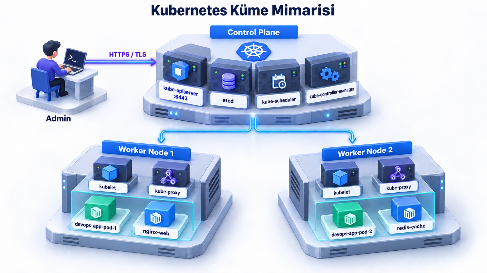
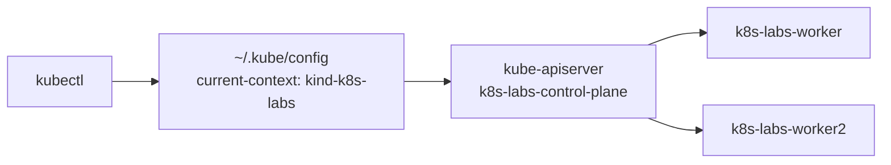

# B01 — Cluster, kubectl ve Namespace

| Profil / Araçlar | Açık Portlar |
|---|---|
| `kind`, `kubectl`, `docker`, `nginx:1.30-alpine` | — |

## Amaç

- Cluster bileşenlerini ve node'ları görmek.
- kubeconfig, context ve namespace ile doğru hedefe komut göndermek.
- Label ve selector ile kaynak seçmek.

## Ön Koşullar

- Ana README'deki kurulum tamamlanmış ve `k8s-labs` Kind cluster'ı çalışıyor olmalıdır.
- `kubectl get nodes` komutu üç node'u `Ready` göstermelidir.

## Mimari ve Çalışma Modeli

{width=60%}

Kind, her Kubernetes node'unu bir Docker container'ı olarak çalıştırır. Bu eğitimdeki cluster bir control-plane ve iki worker node'dan oluşur. `kubectl`, kubeconfig dosyasındaki aktif context'e bakarak hangi API sunucusuna hangi kimlikle bağlanacağını bulur:



Bir context üç bilginin birleşimidir:

| Alan | Görevi |
|---|---|
| `cluster` | API sunucusunun adresi ve CA sertifikası |
| `user` | Kimlik doğrulama bilgisi (sertifika veya token) |
| `namespace` | Komutta belirtilmezse kullanılan namespace (yoksa `default`) |

Yanlış context seçiliyken çalışan geçerli bir `kubectl apply`, doğru manifesti yanlış cluster'a gönderir. Bu yüzden değişiklik yapan komutlardan önce context kontrol edilir.

## Adım Adım Uygulama Rehberi

### 1. Kind Cluster'ını ve Node Container'larını Görme

```bash
cd ~/k8s-labs/beginner/lab-b01-cluster-kubectl-namespace
```

```bash
kind get clusters
```

Kind node'ları birer Docker container'ıdır:

```bash
docker ps --filter label=io.x-k8s.kind.cluster=k8s-labs --format 'table {{.Names}}\t{{.Status}}'
```

### 2. Kubeconfig ve Context

```bash
kubectl config get-contexts
```

```bash
kubectl config current-context
```

Kind, cluster adının başına `kind-` ekleyerek context oluşturur: cluster `k8s-labs`, context `kind-k8s-labs`.

Aktif context'in ayarlarını görün. `--minify` yalnızca aktif context'i gösterir; sertifika verileri gizlenir:

```bash
kubectl config view --minify
```

`kubectl config view --raw` çıktısı kimlik bilgilerini açık gösterir; bu çıktıyı kimseyle paylaşmayın.

Ana cluster'ı açıkça seçin ve bağlantıyı doğrulayın:

```bash
kubectl config use-context kind-k8s-labs
```

```bash
kubectl cluster-info
```

### 3. Node'ları ve Sistem Bileşenlerini İnceleme

```bash
kubectl get nodes -o wide
```

Control-plane bileşenleri `kube-system` namespace'inde Pod olarak çalışır:

```bash
kubectl get pods -n kube-system -o wide
```

Çıktıda control-plane üzerinde `etcd`, `kube-apiserver`, `kube-scheduler` ve `kube-controller-manager`; her node'da bir `kube-proxy` ve `kindnet` (Pod ağı); ayrıca `coredns` (cluster DNS) görünür.

Bir worker node'un ayrıntısını inceleyin. Çıktıda `Labels`, `Taints`, `Conditions` ve `Allocated resources` bölümlerini bulun:

```bash
kubectl describe node k8s-labs-worker
```

### 4. API Kaynaklarını Keşfetme

Cluster'ın tanıdığı kaynak türleri, kısa adları ve namespace'e bağlı olup olmadıkları:

```bash
kubectl api-resources | head -25
```

Bir alanın ne işe yaradığını YAML yazmadan önce `explain` ile öğrenin:

```bash
kubectl explain pod.spec.containers.image
```

```bash
kubectl explain deployment.spec.replicas
```

### 5. Namespace

Namespace, kaynakları mantıksal olarak ayırır. Cluster ile gelen namespace'ler:

```bash
kubectl get namespaces
```

Manifest, `cluster-basics` namespace'ini ve içinde iki Pod'u tanımlar:

```bash
cat starter/labeled-pods.yaml
```

```bash
kubectl apply -f starter/labeled-pods.yaml
```

Namespace belirtmeden Pod'ları listeleyin; `default` namespace'te bu Pod'lar yoktur:

```bash
kubectl get pods
```

```bash
kubectl get pods -n cluster-basics
```

`STATUS` sütununda `ContainerCreating` görürseniz image hâlâ iniyordur; birkaç saniye sonra komutu tekrar çalıştırın.

Tüm namespace'lerdeki Pod'lar:

```bash
kubectl get pods -A
```

Sürekli `-n` yazmamak için aktif context'in varsayılan namespace'ini değiştirebilirsiniz:

```bash
kubectl config set-context --current --namespace=cluster-basics
```

```bash
kubectl get pods
```

Varsayılanı geri alın. Sonraki lablar `default` varsayılanını bekler:

```bash
kubectl config set-context --current --namespace=default
```

### 6. Label ve Selector

Label'lar nesnelere eklenen anahtar-değer etiketleridir. Service, Deployment ve diğer controller'lar Pod'ları label'larıyla bulur.

```bash
kubectl get pods -n cluster-basics --show-labels
```

Yalnızca frontend katmanını seçin:

```bash
kubectl get pods -n cluster-basics -l tier=frontend
```

İki koşulu birlikte kullanın:

```bash
kubectl get pods -n cluster-basics -l 'environment=training,tier=backend'
```

Liste tabanlı seçim (`in`):

```bash
kubectl get pods -n cluster-basics -l 'tier in (frontend,backend)'
```

Label ekleyin, değiştirin ve sütun olarak gösterin:

```bash
kubectl label pod frontend -n cluster-basics owner=platform
```

```bash
kubectl label pod frontend -n cluster-basics owner=operations --overwrite
```

```bash
kubectl get pods -n cluster-basics -L owner,tier
```

### 7. Events ile Ne Olduğunu Görme

Kubernetes yaptığı işleri Event olarak kaydeder. Sorun giderirken ilk bakılacak yerlerden biridir:

```bash
kubectl get events -n cluster-basics --sort-by=.metadata.creationTimestamp
```

<details><summary><strong>8. İsteğe Bağlı: İkinci Cluster ve Context Değiştirme</strong></summary>

Bu bölüm yaklaşık 1 GB ek bellek kullanır. İki cluster arasında geçiş yapmayı görmek için tek node'lu geçici bir cluster oluşturun:

```bash
kind create cluster --name k8s-test --wait 120s
```

`kind create`, yeni cluster'ın context'ini otomatik olarak aktif yapar:

```bash
kubectl config current-context
```

```bash
kubectl get nodes
```

`--context`, yalnızca o komut için hedef cluster'ı değiştirir; aktif context'e dokunmaz:

```bash
kubectl --context kind-k8s-labs get nodes
```

Kubeconfig kaybolursa Kind çalışan cluster'dan yeniden üretebilir. Ana dosyaya dokunmadan ayrı bir dosyaya yazıp test edin:

```bash
(umask 077; kind get kubeconfig --name k8s-labs > /tmp/k8s-labs-recovered.yaml)
```

```bash
kubectl --kubeconfig /tmp/k8s-labs-recovered.yaml get nodes
```

Ana cluster'a dönün ve geçici cluster'ı silin:

```bash
kubectl config use-context kind-k8s-labs
```

```bash
kind delete cluster --name k8s-test
```

```bash
rm -f /tmp/k8s-labs-recovered.yaml
```

</details>

## Temizlik

```bash
kubectl delete namespace cluster-basics
```

```bash
kind delete cluster --name k8s-test 2>/dev/null || true
```

Ana `k8s-labs` cluster'ı silinmez; sonraki lablar onu kullanır.
