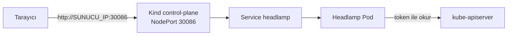

# B02 — Headlamp ile Cluster'ı Görsel İzleme

| Profil / Araçlar | Açık Portlar |
|---|---|
| `helm`, `kubectl`, Headlamp `0.46.0` | 30086 (NodePort) |

## Amaç

- Headlamp'ı Helm ile kurmak.
- Salt-okunur token ile arayüze girmek.
- `kubectl` değişikliklerini arayüzden izlemek.

## Ön Koşullar

- B01 tamamlanmış, `kind-k8s-labs` context'i aktif olmalıdır.
- Cluster `kind-cluster.yaml` ile oluşturulmuş olmalıdır. Bu dosya NodePort `30086`'yı sunucunun `30086` portuna bağlar.
- Sunucunun firewall'unda `30086` portu açık olmalıdır. Kapalıysa 2. adımdaki SSH tüneliyle erişin.
- B06 da `30086` portunu kullanır. Headlamp'ı B06'ya geçmeden önce kaldırın (Temizlik).

## Mimari ve Çalışma Modeli

Headlamp cluster içinde bir Pod olarak çalışır ve Kubernetes API'sini, giriş yapan kullanıcının token'ıyla okur. Arayüz NodePort Service ile Kind control-plane container'ının `30086` portundan açılır; Kind bu portu sunucunun `30086` portuna eşler. Tarayıcıdan `http://SUNUCU_IP:30086` adresiyle erişilir.



Token, `headlamp-viewer` adlı ServiceAccount'a aittir. Bu hesaba Kubernetes'in hazır `view` rolü verilir: kaynakları okuyabilir ama değiştiremez ve Secret içeriklerini göremez.

## Adım Adım Uygulama Rehberi

### 1. Headlamp'ı Helm ile Kurma

```bash
cd ~/k8s-labs/beginner/lab-b02-headlamp
```

Helm, Kubernetes için paket yöneticisidir; Headlamp'ı tek komutla kurmak için kullanılır. Helm, A01 labında ayrıntılı anlatılır.

```bash
helm repo add headlamp https://kubernetes-sigs.github.io/headlamp/
```

```bash
helm repo update headlamp
```

Sabit chart sürümüyle, Service'i NodePort `30086` olacak şekilde kurun:

```bash
helm upgrade --install headlamp headlamp/headlamp \
  --version 0.46.0 \
  --namespace headlamp --create-namespace \
  --set service.type=NodePort \
  --set service.nodePort=30086 \
  --wait --timeout 5m
```

```bash
kubectl get pods,service -n headlamp
```

`PORT(S)` sütununda `80:30086/TCP` görünür.

### 2. Arayüze Erişimi Doğrulama

Sunucu üzerinden. Yeni açılan port birkaç saniye içinde hazır olur; `--retry` bunu bekler:

```bash
curl -s -o /dev/null -w '%{http_code}\n' --retry 5 --retry-all-errors --retry-delay 2 http://127.0.0.1:30086/
```

Tarayıcıdan iki yolla erişebilirsiniz.

**a) Doğrudan IP ile.** Sunucunun firewall'unda `30086` açıksa adres şudur:

```bash
echo "http://$(curl -s ifconfig.me):30086"
```

Bağlantı HTTP'dir; giriş token'ı şifresiz gider. Bu yüzden 3. adımda salt-okunur ve 8 saat geçerli bir token kullanılır.

**b) SSH tüneliyle.** Port dışarıya kapalıysa ya da bağlantının şifreli olmasını istiyorsanız kullanın. Komutu sunucuda değil, **kendi bilgisayarınızın** terminalinde çalıştırın:

```text
ssh -fN -L 30086:127.0.0.1:30086 student@SUNUCU_IP
```

- `-L 30086:127.0.0.1:30086`: bilgisayarınızın `30086` portuna gelen bağlantıyı SSH içinden sunucunun `127.0.0.1:30086` adresine taşır. Trafik SSH ile şifrelenir.
- `-N`: sunucuda komut çalıştırmaz, shell açmaz; yalnızca tüneli kurar.
- `-f`: bağlantı kurulunca arka plana geçer; terminaliniz serbest kalır.

Ardından tarayıcıda `http://localhost:30086` adresini açın. Windows'taki `ssh` `-f` ile arka plana geçemeyebilir; o zaman komutu `-f` olmadan ayrı bir PowerShell penceresinde çalıştırın ve pencereyi açık bırakın. Tüneli kapatma komutu Temizlik bölümündedir.

### 3. Salt-Okunur Giriş Token'ı Üretme

Arayüze girecek kimliği oluşturun ve hazır `view` rolünü bağlayın:

```bash
kubectl create serviceaccount headlamp-viewer -n headlamp
```

```bash
kubectl create clusterrolebinding headlamp-viewer \
  --clusterrole=view \
  --serviceaccount=headlamp:headlamp-viewer
```

8 saat geçerli bir token üretin ve çıktıyı kopyalayın:

```bash
kubectl create token headlamp-viewer -n headlamp --duration=8h
```

Tarayıcıda Headlamp adresini açın, **Token** kutusuna yapıştırıp **Authenticate** düğmesine basın.

Açılışta `Lost connection to the cluster ... Unauthorized` görürseniz tarayıcıda önceki kurulumdan kalan bir token vardır; o token'ın hesabı silindiği için reddedilir. Sağ üstteki menüden **Log out** yapın (ya da gizli pencere açın) ve yeni token'ı yapıştırın.

### 4. Arayüzü Tanıma

Sol menüden şu bölümleri açın:

- **Cluster → Nodes:** üç node ve Kubernetes sürümü. CPU ve bellek grafikleri boş görünür; bu değerler için cluster'da `metrics-server` gerekir.
- **Cluster → Namespaces:** `kube-system`, `headlamp` ve diğerleri.
- **Workloads → Pods:** `kube-system` içindeki sistem Pod'ları; bir Pod'a tıklayıp **Logs** sekmesine bakın.
- **Config → Secrets:** `view` rolü Secret okumaya izin vermediği için liste boş gelir veya erişim uyarısı görünür.

### 5. Değişiklikleri Canlı İzleme

Headlamp'ta **Workloads → Deployments** sayfası açıkken terminalden bir uygulama oluşturun:

```bash
kubectl create namespace headlamp-demo
```

```bash
kubectl create deployment demo-web --image=nginx:1.30-alpine --replicas=2 -n headlamp-demo
```

```bash
kubectl rollout status deployment/demo-web -n headlamp-demo --timeout=120s
```

Pod sayısını artırın ve arayüzde yeni Pod'ların belirdiğini izleyin:

```bash
kubectl scale deployment/demo-web --replicas=4 -n headlamp-demo
```

```bash
kubectl rollout status deployment/demo-web -n headlamp-demo --timeout=120s
```

Arayüzden silme veya ölçekleme denediğinizde işlem reddedilir; token salt-okunurdur. Değişiklikler bu eğitimde `kubectl` ile yapılır, Headlamp izlemek için kullanılır.

## Temizlik

Demo uygulamasını silin:

```bash
kubectl delete namespace headlamp-demo
```

SSH tüneli açtıysanız kendi bilgisayarınızda kapatın:

```text
pkill -f "30086:127.0.0.1:30086"
```

Headlamp `30086` portunu tutar. B06 aynı portu kullandığı için Headlamp'ı B06'ya geçmeden önce kaldırın:

```bash
helm uninstall headlamp -n headlamp
```

```bash
kubectl delete clusterrolebinding headlamp-viewer
```

```bash
kubectl delete namespace headlamp
```
