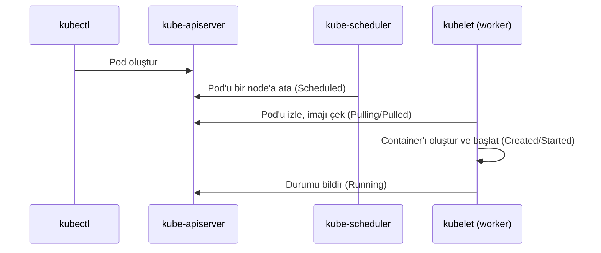

# B03 — İlk Pod: kubectl run, describe, logs, exec

| Profil / Araçlar | Açık Portlar |
|---|---|
| `kubectl`, `nginx:1.30-alpine`, `curl` | 28080 (yalnızca port-forward süresince, `127.0.0.1`) |

## Amaç

- Tek komutla Pod çalıştırmak.
- Pod'u `describe`, `logs` ve `exec` ile incelemek.
- Komuttan YAML üretip `apply` ile yönetmek.

## Ön Koşullar

- B01 tamamlanmış, `kind-k8s-labs` context'i aktif olmalıdır.
- Sunucuda `127.0.0.1:28080` portu boş olmalıdır.

## Mimari ve Çalışma Modeli

**Pod**, Kubernetes'in çalıştırdığı en küçük nesnedir: bir veya birden fazla container, ortak bir IP adresi ve isteğe bağlı paylaşılan diskler. Bir Pod oluşturulduğunda olaylar şu sırayla gerçekleşir:



İki çalışma biçimi vardır:

| Yaklaşım | Örnek | Ne zaman |
|---|---|---|
| Imperative | `kubectl run`, `kubectl delete` | Hızlı deneme ve sorun giderme |
| Declarative | YAML dosyası + `kubectl apply -f` | Kalıcı, Git'te saklanan, tekrarlanabilir yönetim |

## Adım Adım Uygulama Rehberi

### 1. Namespace Oluşturma

```bash
cd ~/k8s-labs/beginner/lab-b03-first-pod
```

```bash
kubectl create namespace b03-pod
```

### 2. Tek Komutla İlk Pod

```bash
kubectl run my-first-pod --image=nginx:1.30-alpine --port=80 -n b03-pod
```

Pod'un durumunu, IP adresini ve çalıştığı node'u görün:

```bash
kubectl get pods -n b03-pod -o wide
```

`STATUS` sütununda `ContainerCreating` görürseniz image hâlâ iniyordur; birkaç saniye sonra komutu tekrar çalıştırın.

### 3. describe ve Events

```bash
kubectl describe pod my-first-pod -n b03-pod
```

Çıktının sonundaki **Events** tablosunda yaşam döngüsünü izleyin: `Scheduled` (node'a atandı), `Pulling`/`Pulled` (imaj çekildi), `Created`, `Started`. Pod çalışmadığında ilk bakılacak yer burasıdır.

Pod'un API'de saklanan tam tanımı:

```bash
kubectl get pod my-first-pod -n b03-pod -o yaml | head -40
```

### 4. Loglar

Container'ın standart çıktısı:

```bash
kubectl logs my-first-pod -n b03-pod
```

Son satırlar ve zaman damgası:

```bash
kubectl logs my-first-pod -n b03-pod --tail=5 --timestamps
```

### 5. Container İçinde Komut Çalıştırma

Tek komut çalıştırıp çıkın:

```bash
kubectl exec my-first-pod -n b03-pod -- nginx -v
```

```bash
kubectl exec my-first-pod -n b03-pod -- cat /etc/os-release
```

Etkileşimli kabuk açın, birkaç komut deneyin ve `exit` ile çıkın:

```bash
kubectl exec -it my-first-pod -n b03-pod -- sh
```

```bash
hostname
```

```bash
ls /usr/share/nginx/html
```

```bash
exit
```

### 6. port-forward ile Uygulamaya Erişme

`port-forward`, sunucunun `127.0.0.1:28080` adresini Pod'un 80 portuna geçici olarak bağlar. Arka planda başlatın ve süreç numarasını saklayın:

```bash
kubectl port-forward pod/my-first-pod 28080:80 -n b03-pod >/dev/null 2>&1 &
PF_PID=$!
sleep 3
```

```bash
curl -s http://127.0.0.1:28080 | grep '<title>'
```

Nginx erişim logunda isteğinizi görün:

```bash
kubectl logs my-first-pod -n b03-pod --tail=1
```

Yönlendirmeyi kapatın:

```bash
kill "$PF_PID"
```

`port-forward` geliştirme ve sorun giderme içindir; uygulamayı kalıcı olarak açmak için B06'da Service kullanılır.

### 7. Komuttan YAML Üretme ve Declarative Yönetim

`--dry-run=client -o yaml`, komutu cluster'a göndermeden karşılık gelen manifesti üretir. Sıfırdan YAML yazmak yerine iyi bir başlangıç noktasıdır:

```bash
kubectl run my-simple-pod --image=nginx:1.30-alpine --port=80 \
  --dry-run=client -o yaml > my-simple-pod.yaml
```

```bash
cat my-simple-pod.yaml
```

Manifesti declarative olarak uygulayın:

```bash
kubectl apply -f my-simple-pod.yaml -n b03-pod
```

Dosyaya bir label ekleyip tekrar uygulayın. `apply`, dosyadaki istenen durumu cluster'a taşır:

```bash
sed -i 's/    run: my-simple-pod/    run: my-simple-pod\n    tier: web/' my-simple-pod.yaml
```

```bash
kubectl apply -f my-simple-pod.yaml -n b03-pod
```

```bash
kubectl get pods -n b03-pod --show-labels
```

### 8. Pod Silme

Imperative yöntemle oluşturduğunuz ilk Pod'u silin:

```bash
kubectl delete pod my-first-pod -n b03-pod
```

```bash
kubectl get pods -n b03-pod
```

Silinen Pod geri gelmez; onu yeniden oluşturacak bir denetleyici yoktur. Bu konu B05'te ele alınır.

## Temizlik

```bash
kubectl delete namespace b03-pod
```

```bash
rm -f my-simple-pod.yaml
```
