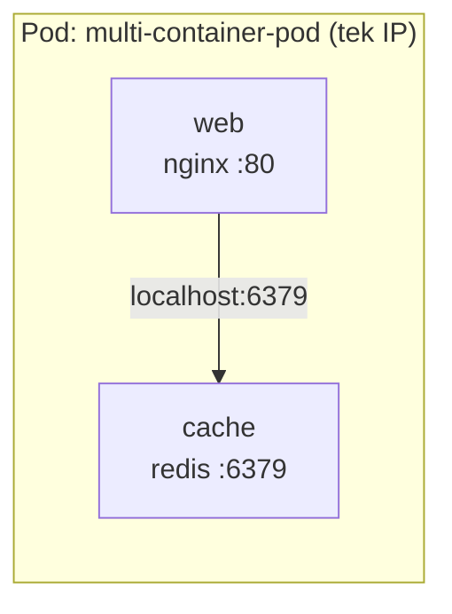
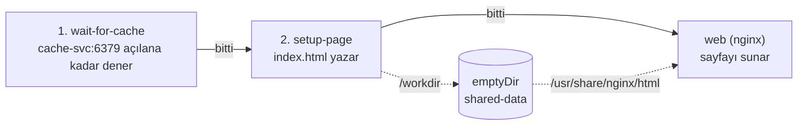
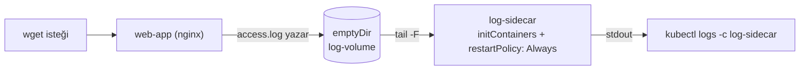

# B04 — Multi-container, Init ve Sidecar

| Profil / Araçlar | Açık Portlar |
|---|---|
| `kubectl`, `nginx:1.30-alpine`, `redis:8.4-alpine`, `busybox:1.37` | — |

## Amaç

- Aynı Pod'daki container'ların ağ ve disk paylaşımını görmek.
- Init container ile bağımlılık beklemek.
- Sidecar ile ana uygulamanın logunu okumak.

## Ön Koşullar

- B03 tamamlanmış olmalıdır.

## Mimari ve Çalışma Modeli

Bir Pod'daki tüm container'lar aynı ağ ad alanını paylaşır: birbirlerine `localhost` ile ulaşır, aynı portu iki container dinleyemez. `emptyDir` gibi bir volume'u birden fazla container'a bağlayarak dosya paylaşabilirler. Lab üç ayrı Pod'la üç deseni gösterir; her bölümün başında o Pod'un şeması vardır.

| Tür | Tanım yeri | Davranış |
|---|---|---|
| Container | `spec.containers` | Pod boyunca çalışan ana süreçler |
| Init container | `spec.initContainers` | Sırayla çalışır, her biri başarıyla bitmeden sonraki ve ana container'lar başlamaz |
| Sidecar | `spec.initContainers` + `restartPolicy: Always` | Ana container'lardan önce başlar ve Pod boyunca çalışmaya devam eder |

## Adım Adım Uygulama Rehberi

### 1. Namespace Oluşturma

```bash
cd ~/k8s-labs/beginner/lab-b04-multi-container-init-sidecar
```

```bash
kubectl create namespace b04-patterns
```

### 2. Multi-container Pod: Nginx ve Redis



İki container aynı Pod IP'sini ve aynı `localhost`'u paylaşır. Ayrı Pod'larda olsalardı birbirlerine bir Service adıyla ulaşmaları gerekirdi (3. adımdaki `cache-svc` gibi).

```bash
cat starter/multi-container-pod.yaml
```

```bash
kubectl apply -f starter/multi-container-pod.yaml -n b04-patterns
```

```bash
kubectl get pod multi-container-pod -n b04-patterns
```

`READY` sütunu `2/2` gösterir: Pod'daki iki container da hazır. `0/2` ve `ContainerCreating` görürseniz image'lar hâlâ iniyordur; `2/2` olana kadar birkaç saniye arayla komutu tekrar çalıştırın.

Birden fazla container varken `logs` ve `exec` komutlarına `-c` ile container adı verilir:

```bash
kubectl exec multi-container-pod -c cache -n b04-patterns -- redis-cli ping
```

Web container'ından Redis'e `localhost` üzerinden erişin. İki container aynı ağı paylaşır:

```bash
kubectl exec multi-container-pod -c web -n b04-patterns -- nc -zv 127.0.0.1 6379
```

```bash
kubectl logs multi-container-pod -c cache -n b04-patterns --tail=3
```

### 3. Init Container: Bağımlılığı Bekleme ve Veri Hazırlama



Init container'lar sırayla çalışır ve işini bitirip kapanır. Biri bitmeden sonraki başlamaz; ikisi de bitmeden `web` başlamaz. `STATUS` sütunu bu sırayı gösterir: `Init:0/2` → `Init:1/2` → `Running`. Beklenen `cache-svc`, 2. adımdaki Pod'un Redis'ine giden Service'tir.

Bu Pod'un iki init container'ı vardır. İlki `cache-svc` adlı Service'e ulaşılana kadar bekler, ikincisi web sayfasını ortak diske yazar:

```bash
cat starter/init-container-pod.yaml
```

Henüz `cache-svc` yokken Pod'u oluşturun:

```bash
kubectl apply -f starter/init-container-pod.yaml -n b04-patterns
```

```bash
sleep 10; kubectl get pod init-container-pod -n b04-patterns
```

`STATUS` sütunu `Init:0/2` gösterir: ilk init container bekliyor, ana container başlamadı. Nedenini logda görün:

```bash
kubectl logs init-container-pod -c wait-for-cache -n b04-patterns --tail=3
```

Beklenen Service'i oluşturun. Service, B06'da ayrıntılı anlatılır; burada Redis'e bir DNS adı verir:

```bash
kubectl apply -f starter/cache-service.yaml -n b04-patterns
```

```bash
kubectl wait --for=condition=Ready pod/init-container-pod -n b04-patterns --timeout=120s
```

```bash
kubectl logs init-container-pod -c wait-for-cache -n b04-patterns --tail=1
```

Init container'ın yazdığı sayfayı nginx sunuyor:

```bash
kubectl exec init-container-pod -c web -n b04-patterns -- wget -qO- http://localhost
```

### 4. Sidecar: Ana Uygulamanın Loglarını Okuma



Sidecar, ana uygulamanın koduna dokunmadan yanında çalışan yardımcı container'dır. Burada nginx'in dosyaya yazdığı logu stdout'a aktarır; böylece log `kubectl logs` ile okunabilir. Init container'dan farkı, işini bitirip kapanmaması ve Pod boyunca çalışmasıdır.

Nginx erişim logunu ortak `emptyDir` diskine yazar; sidecar aynı dosyayı okuyup kendi çıktısına aktarır:

```bash
cat starter/sidecar-container-pod.yaml
```

```bash
kubectl apply -f starter/sidecar-container-pod.yaml -n b04-patterns
```

```bash
kubectl wait --for=condition=Ready pod/sidecar-container-pod -n b04-patterns --timeout=120s
```

İki istek gönderin; biri var olan, biri olmayan sayfaya:

```bash
kubectl exec sidecar-container-pod -c web-app -n b04-patterns -- wget -qO- http://localhost/ >/dev/null
```

```bash
kubectl exec sidecar-container-pod -c web-app -n b04-patterns -- wget -qO- http://localhost/olmayan-sayfa 2>/dev/null || true
```

Sidecar dosyayı yaklaşık saniyede bir okur. Birkaç saniye bekleyip logları sidecar'dan okuyun:

```bash
sleep 3; kubectl logs sidecar-container-pod -c log-sidecar -n b04-patterns
```

Çıktıda `"GET / HTTP/1.1" 200` ve `"GET /olmayan-sayfa HTTP/1.1" 404` satırları görünür.

## Temizlik

```bash
kubectl delete namespace b04-patterns
```
