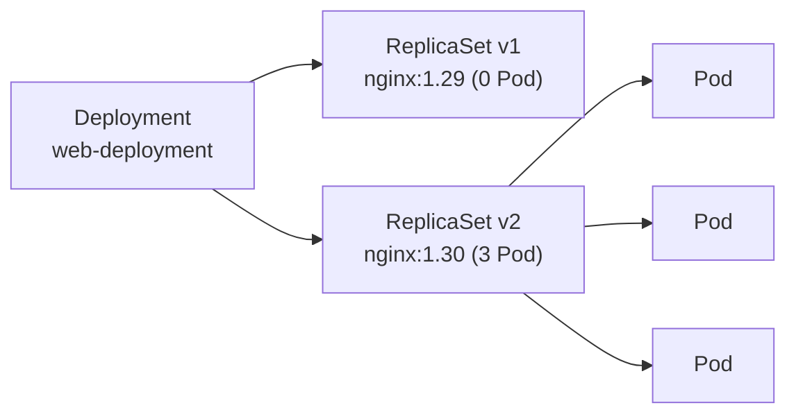
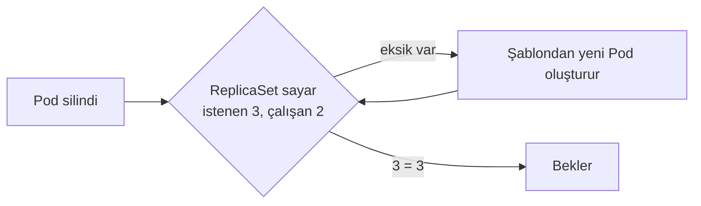
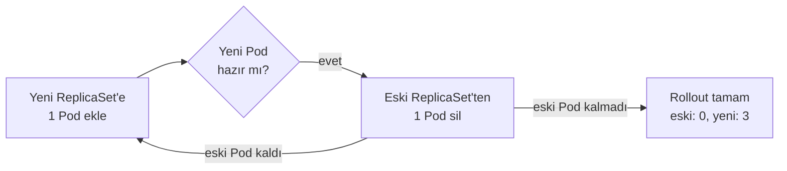

# B05 — Deployment ve Rollout

| Profil / Araçlar | Açık Portlar |
|---|---|
| `kubectl`, `nginx:1.29-alpine`, `nginx:1.30-alpine` | — |

## Amaç

- Tek Pod ile ReplicaSet arasındaki farkı görmek.
- Deployment ile ölçeklemek ve sürüm güncellemek.
- Rollout geçmişini okuyup geri almak.

## Ön Koşullar

- B03 tamamlanmış olmalıdır.

## Mimari ve Çalışma Modeli

Kubernetes'te denetleyiciler (controller) sürekli **istenen durum** ile **mevcut durumu** karşılaştırır ve farkı kapatır. Deployment doğrudan Pod yönetmez; her sürüm için bir ReplicaSet oluşturur, Pod'ları ReplicaSet yönetir:



Sürüm güncellenince yeni ReplicaSet büyütülür, eski ReplicaSet küçültülür. Eski ReplicaSet silinmez, 0 Pod ile saklanır; `rollout undo` onu tekrar büyütür.

## Adım Adım Uygulama Rehberi

### 1. Namespace Oluşturma

```bash
cd ~/k8s-labs/beginner/lab-b05-deployment-rollout
```

```bash
kubectl create namespace b05-deploy
```

### 2. Tek Başına Pod: Self-healing Yok

```bash
kubectl apply -f starter/pod-alone.yaml -n b05-deploy
```

```bash
kubectl get pods -n b05-deploy
```

`lone-pod` `Running` durumundadır. `STATUS` sütununda `ContainerCreating` görürseniz image hâlâ iniyordur; birkaç saniye sonra komutu tekrar çalıştırın. Şimdi Pod'u silin:

```bash
kubectl delete pod lone-pod -n b05-deploy
```

```bash
kubectl get pods -n b05-deploy
```

`No resources found`: Pod'u izleyen bir denetleyici olmadığı için geri gelmez.

### 3. ReplicaSet ile Self-healing



ReplicaSet istenen Pod sayısını sürekli çalışan sayıyla karşılaştırır ve farkı kapatır. 2. adımdaki tek başına Pod'u izleyen böyle bir denetleyici yoktu.

```bash
cat starter/replicaset.yaml
```

```bash
kubectl apply -f starter/replicaset.yaml -n b05-deploy
```

```bash
kubectl get replicaset,pods -n b05-deploy
```

Bir Pod'u silin ve hemen listeleyin:

```bash
POD_TO_DELETE=$(kubectl get pods -n b05-deploy -l app=frontend -o jsonpath='{.items[0].metadata.name}')
kubectl delete pod "$POD_TO_DELETE" -n b05-deploy
```

```bash
kubectl get pods -n b05-deploy -l app=frontend
```

ReplicaSet eksilen Pod'un yerine farklı adla yenisini üretir; sayı 3'te kalır.

### 4. ReplicaSet Sürüm Güncelleyemez

ReplicaSet şablonundaki imajı değiştirin:

```bash
kubectl set image replicaset/frontend-rs nginx=nginx:1.30-alpine -n b05-deploy
```

ReplicaSet'in şablonu değişti; `IMAGES` sütunu `nginx:1.30-alpine` gösterir:

```bash
kubectl get replicaset frontend-rs -n b05-deploy -o wide
```

Çalışan Pod'ların imajına bakın:

```bash
kubectl get pods -n b05-deploy -l app=frontend -o jsonpath='{range .items[*]}{.metadata.name} {.spec.containers[0].image}{"\n"}{end}'
```

Pod'lar hâlâ `nginx:1.29-alpine` çalıştırır. ReplicaSet yalnızca Pod sayısını korur; mevcut Pod'ları yeni şablona göre yenilemez. Sürüm güncellemesi için Deployment kullanılır.

```bash
kubectl delete -f starter/replicaset.yaml -n b05-deploy
```

### 5. Deployment Oluşturma

```bash
cat starter/deployment.yaml
```

```bash
kubectl apply -f starter/deployment.yaml -n b05-deploy
```

Deployment'ın oluşturduğu ReplicaSet'i ve Pod'ları görün. Pod adları ReplicaSet adıyla başlar:

```bash
kubectl get deployment,replicaset,pods -n b05-deploy
```

Deployment satırında `READY` sütunu `3/3` olmalıdır. `STATUS` sütununda `ContainerCreating` görürseniz image hâlâ iniyordur; birkaç saniye sonra komutu tekrar çalıştırın.

### 6. Ölçekleme

Ölçekleme yalnızca Pod sayısını değiştirir; imaj aynı kaldığı için yeni ReplicaSet açılmaz, aynı ReplicaSet büyür veya küçülür.

Pod sayısını 5'e çıkarın:

```bash
kubectl scale deployment/web-deployment --replicas=5 -n b05-deploy
```

```bash
kubectl get pods -n b05-deploy
```

Beş Pod görünür; `AGE` sütunu birkaç saniye olan ikisi yeni açılanlardır. Tekrar 3'e indirin:

```bash
kubectl scale deployment/web-deployment --replicas=3 -n b05-deploy
```

```bash
kubectl get pods -n b05-deploy
```

Fazla iki Pod `Terminating` durumuna geçer ve kısa süre sonra listeden çıkar.

### 7. Sürüm Güncelleme (Rollout)



Deployment, yeni imaj için yeni bir ReplicaSet açar ve Pod'ları birer birer değiştirir; yeni Pod hazır olmadan eskisi silinmez, hizmet kesilmez. Eski ReplicaSet 0 Pod ile saklanır; 8. adımdaki rollback ona döner.

Şu anki imaj:

```bash
kubectl describe deployment web-deployment -n b05-deploy | grep Image
```

`Image: nginx:1.29-alpine` görünür. İmajı `1.30` yapın. `nginx=` kısmı Deployment içindeki container'ın adıdır:

```bash
kubectl set image deployment/web-deployment nginx=nginx:1.30-alpine -n b05-deploy
```

`rollout status` güncellemeyi canlı izler: Pod'lar değiştikçe `... of 3 updated replicas are available` satırları gelir, bitince `successfully rolled out` yazar:

```bash
kubectl rollout status deployment/web-deployment -n b05-deploy --timeout=120s
```

İmaj değişti:

```bash
kubectl describe deployment web-deployment -n b05-deploy | grep Image
```

Artık iki ReplicaSet vardır. `IMAGES` sütununa bakın: `1.29` olan eskisi 0 Pod ile, `1.30` olan yenisi 3 Pod ile durur:

```bash
kubectl get replicaset -n b05-deploy -o wide
```

Her imaj değişikliği bir revizyon olarak kaydedilir. `1` ilk sürüm (`1.29`), `2` güncelleme (`1.30`). `CHANGE-CAUSE` sütunu `<none>` kalır; burada yalnızca revizyon numaralarına bakın:

```bash
kubectl rollout history deployment/web-deployment -n b05-deploy
```

### 8. Geri Alma (Rollback)

Yeni sürümde sorun çıktığını varsayın ve önceki sürüme dönün:

```bash
kubectl rollout undo deployment/web-deployment -n b05-deploy
```

Çıktıdaki `previously managed with 'kubectl apply'` uyarısı beklenir: geri alma, dosyadaki tanımı değiştirmez. Gerçek projelerde kalıcı düzeltme YAML dosyasında yapılıp tekrar `kubectl apply` ile uygulanır.

```bash
kubectl rollout status deployment/web-deployment -n b05-deploy --timeout=120s
```

İmaj yeniden `nginx:1.29-alpine` oldu:

```bash
kubectl describe deployment web-deployment -n b05-deploy | grep Image
```

Eski ReplicaSet yeniden 3 Pod'a çıktı, `1.30` olan 0'a indi:

```bash
kubectl get replicaset -n b05-deploy -o wide
```

Geri alma yeni bir revizyon olarak kaydedilir: revizyon `1` listeden çıkar, aynı sürüm `3` numarasıyla görünür:

```bash
kubectl rollout history deployment/web-deployment -n b05-deploy
```

### 9. Deployment Altındaki Pod'u Silme

```bash
kubectl delete pod -n b05-deploy -l app=web --wait=false
```

```bash
kubectl get pods -n b05-deploy
```

`Terminating` olanlar silinen Pod'lardır; yanlarında farklı adlı üç yeni Pod açılır. Komutu birkaç saniye sonra tekrar çalıştırdığınızda yalnızca yeni Pod'lar `Running` görünür.

## Temizlik

```bash
kubectl delete namespace b05-deploy
```
