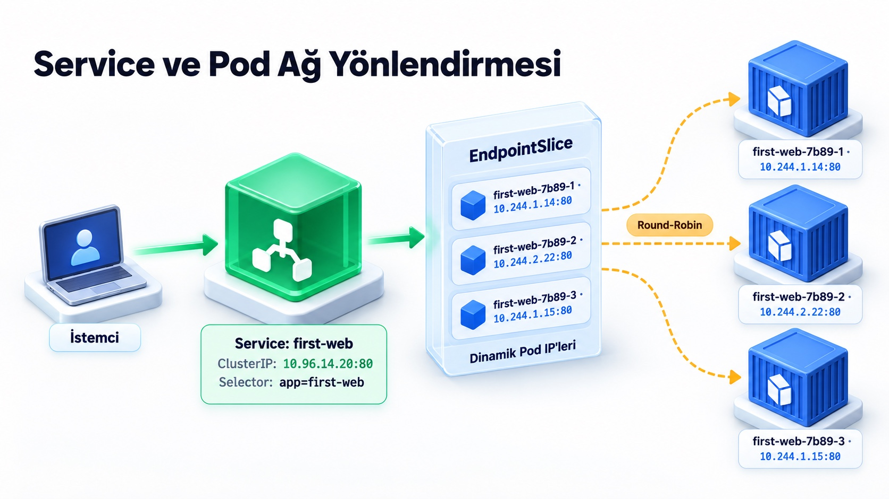
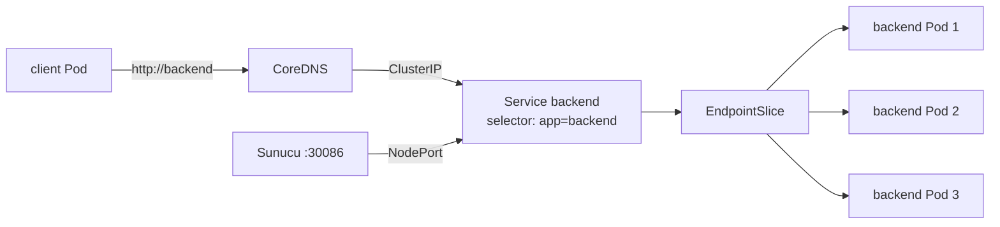

# B06 — Service ve DNS

| Profil / Araçlar | Açık Portlar |
|---|---|
| `kubectl`, `agnhost:2.61`, `busybox:1.37`, `curl` | 30086 (NodePort) |

## Amaç

- ClusterIP Service ile sabit adres ve yük dağıtımı sağlamak.
- Cluster DNS ile aynı ve farklı namespace'ten erişmek.
- NodePort ile uygulamayı dışarı açmak.

## Ön Koşullar

- B05 tamamlanmış olmalıdır.
- Sunucuda `30086` portu Kind tarafından dinleniyor olmalıdır (`kind-cluster.yaml`).
- B02'deki Headlamp kaldırılmış olmalıdır; o da `30086` portunu kullanır. Kontrol: `kubectl get svc -A | grep 30086` çıktısı boş olmalıdır.

## Mimari ve Çalışma Modeli

{width=60%}

Service, label selector'ına uyan **hazır** Pod'ların IP'lerini EndpointSlice nesnesinde tutar ve kendisine gelen trafiği bu Pod'lara dağıtır. CoreDNS her Service için `<servis>.<namespace>.svc.cluster.local` adını Service'in sabit ClusterIP adresine çözer.



| Tür | Erişim | Kullanım |
|---|---|---|
| ClusterIP | Yalnızca cluster içinden | Servisler arası iletişim (varsayılan) |
| NodePort | Her node'un `30000-32767` aralığındaki portundan | Basit dış erişim, test |
| LoadBalancer | Bulut sağlayıcının dış IP'si | Bulut ortamları; Kind'de `<pending>` kalır |
| ExternalName | DNS takma adı (CNAME) | Cluster dışındaki bir adrese iç ad vermek |

## Adım Adım Uygulama Rehberi

### 1. Backend Uygulaması ve ClusterIP Service

```bash
cd ~/k8s-labs/beginner/lab-b06-service-dns
```

```bash
kubectl create namespace b06-svc
```

`starter/backend.yaml` üç replica'lı bir Deployment ve önüne konan `backend` Service'ini tanımlar. Uygulama `/hostname` isteğine cevap veren Pod'un adını döndürür:

```bash
cat starter/backend.yaml
```

```bash
kubectl apply -f starter/backend.yaml -n b06-svc
```

### 2. Pod IP'leri Değişir

`IP` sütunu her Pod'un cluster içindeki adresidir:

```bash
kubectl get pods -n b06-svc -o wide
```

`STATUS` sütununda `ContainerCreating` görürseniz image hâlâ iniyordur; birkaç saniye sonra komutu tekrar çalıştırın.

Bir Pod'u silin; yerine gelen Pod farklı bir IP alır:

```bash
kubectl delete pod -n b06-svc "$(kubectl get pods -n b06-svc -l app=backend -o jsonpath='{.items[0].metadata.name}')"
```

```bash
kubectl get pods -n b06-svc -o wide
```

Yeni Pod'un adı ve IP'si farklıdır (henüz `ContainerCreating` ise `IP` sütunu `<none>` olabilir; komutu tekrar çalıştırın). Pod IP'sine doğrudan bağlanan bir istemci bu değişiklikte bağlantısını kaybederdi. Service bu sorunu çözer.

### 3. Service ve EndpointSlice

Service'in sabit ClusterIP adresi:

```bash
kubectl get service backend -n b06-svc
```

Service hangi Pod'lara trafik göndereceğini selector ile seçer. `Selector` satırı `app=backend`, `Endpoints` satırı o anda trafik alan Pod adresleridir:

```bash
kubectl describe service backend -n b06-svc | grep -E 'Selector|Endpoints'
```

Bu selector'a uyan Pod'lar:

```bash
kubectl get pods -n b06-svc -l app=backend -o wide
```

Kubernetes bu adresleri EndpointSlice nesnesinde tutar. `ENDPOINTS` sütunundaki IP'ler yukarıdaki Pod IP'leriyle aynıdır:

```bash
kubectl get endpointslice -n b06-svc -l kubernetes.io/service-name=backend
```

### 4. Cluster İçinden Erişim ve Yük Dağıtımı

Aynı namespace'te ve farklı bir namespace'te birer test istemcisi oluşturun:

```bash
kubectl apply -f starter/clients.yaml
```

```bash
kubectl get pod client -n b06-svc
```

```bash
kubectl get pod client -n b06-other
```

İkisi de `Running` olmalıdır. `STATUS` sütununda `ContainerCreating` görürseniz image hâlâ iniyordur; birkaç saniye sonra komutu tekrar çalıştırın.

Service adına altı istek gönderin; cevaplar farklı Pod'lardan gelir:

```bash
for i in 1 2 3 4 5 6; do kubectl exec client -n b06-svc -- wget -qO- http://backend/hostname; echo; done
```

### 5. Cluster DNS

Kısa adın tam adı ve çözüldüğü adres:

```bash
kubectl exec client -n b06-svc -- nslookup backend.b06-svc.svc.cluster.local
```

Çıkan adres, Service'in ClusterIP'siyle aynıdır. Pod'un DNS arama listesi kısa adı nasıl tamamladığını gösterir:

```bash
kubectl exec client -n b06-svc -- cat /etc/resolv.conf
```

Farklı namespace'ten kısa ad çözülmez, çünkü arama listesi `b06-other` namespace'ini dener:

```bash
kubectl exec client -n b06-other -- wget -qO- -T 3 http://backend/hostname || echo "kisa ad bu namespace'te bulunamadi"
```

Namespace'i ekleyince çalışır:

```bash
kubectl exec client -n b06-other -- wget -qO- http://backend.b06-svc/hostname; echo
```

### 6. Label Değişikliğinin Service'e Etkisi

Service, Pod'u adıyla değil label'ıyla bulur. Bir Pod'un label'ını değiştirip ne olduğunu adım adım izleyin.

Önce EndpointSlice'taki üç IP'yi not edin:

```bash
kubectl get endpointslice -n b06-svc -l kubernetes.io/service-name=backend
```

Bir backend Pod'u seçin; adını, IP'sini ve label'larını görün:

```bash
WEB_POD=$(kubectl get pods -n b06-svc -l app=backend -o jsonpath='{.items[0].metadata.name}')
kubectl get pod "$WEB_POD" -n b06-svc -o wide --show-labels
```

`LABELS` sütununda `app=backend` vardır. Bu label'ı `app=bakim` yapın:

```bash
kubectl label pod "$WEB_POD" -n b06-svc app=bakim --overwrite
```

Label değişti; Pod hâlâ çalışıyor:

```bash
kubectl get pod "$WEB_POD" -n b06-svc -o wide --show-labels
```

Namespace'teki Pod'lara `APP` sütunuyla bakın:

```bash
kubectl get pods -n b06-svc -o wide -L app
```

Dört backend Pod'u görünür: `APP` sütunu `bakim` olan sizin değiştirdiğiniz, yaşı birkaç saniye olan yeni bir Pod da `backend`. Deployment'ın ReplicaSet'i de Pod'ları label'la saydığı için değiştirilen Pod'u artık kendi Pod'u saymaz ve sayıyı 3'te tutmak için yenisini açar.

Selector'a uyan Pod'lar yine üç tanedir; değiştirilen Pod listede yoktur:

```bash
kubectl get pods -n b06-svc -l app=backend -o wide
```

EndpointSlice'a tekrar bakın. Değiştirilen Pod'un IP'si çıktı, yeni Pod'un IP'si girdi. Yeni Pod hazır olmadan eklenmez; IP görünmüyorsa birkaç saniye sonra tekrar çalıştırın:

```bash
kubectl get endpointslice -n b06-svc -l kubernetes.io/service-name=backend
```

Etiketi değiştirilen Pod çalışmaya devam eder ama trafik almaz. Bu yöntem, sorunlu bir Pod'u silmeden inceleme için trafikten ayırmakta kullanılır.

İnceleme bitince Pod'u silin:

```bash
kubectl delete pod "$WEB_POD" -n b06-svc
```

### 7. NodePort ile Dış Erişim

```bash
cat starter/service-nodeport.yaml
```

```bash
kubectl apply -f starter/service-nodeport.yaml -n b06-svc
```

```bash
kubectl get service backend-nodeport -n b06-svc
```

`PORT(S)` sütunu `80:30086/TCP` gösterir. Yeni portun ağ kurallarına yazılması birkaç saniye sürebilir; `--retry` bu süreyi bekler. Sunucunun kendisinden istek gönderin:

```bash
curl -s --retry 5 --retry-all-errors --retry-delay 2 http://127.0.0.1:30086/hostname; echo
```

Dışarıdan, tarayıcıdan açacağınız adres (sunucunun firewall'unda `30086` açık olmalıdır):

```bash
echo "http://$(curl -s ifconfig.me):30086/hostname"
```

Sayfayı birkaç kez yenileyin; her seferinde cevap veren Pod'un adı değişebilir.

### 8. ExternalName ve LoadBalancer

```bash
kubectl apply -f starter/service-other-types.yaml -n b06-svc
```

```bash
kubectl get services -n b06-svc
```

**LoadBalancer:** `backend-lb` için `EXTERNAL-IP` sütunu `<pending>` kalır. Kubernetes dış IP'yi kendisi üretmez; bunu ortamdaki bir yük dengeleyici yapar:

- **Bulut (EKS, GKE, AKS):** Cluster bulut sağlayıcıyla entegre çalışır. LoadBalancer Service oluşturulunca bulut kendi yük dengeleyicisini açar ve `EXTERNAL-IP` alanına gerçek bir IP yazar.
- **Kendi sunucunuzda (Kind, kubeadm, bare metal):** Hazır bir yük dengeleyici yoktur. LoadBalancer Service'in IP alabilmesi için önceden MetalLB gibi bir yük dengeleyici kurup ona dağıtacağı IP aralığını vermeniz gerekir. Kurulmadıysa IP sonsuza kadar `<pending>` kalır.

`PORT(S)` sütununa bakın: `backend-lb` de `80:3xxxx/TCP` gibi bir NodePort aldı. LoadBalancer, NodePort'un üzerine kurulur; dış yük dengeleyici trafiği node'ların bu portuna gönderir.

**ExternalName:** `docs` Service'inin selector'ı, Pod'u ve ClusterIP'si yoktur; yalnızca bir DNS takma adıdır (CNAME). Cluster içinde `docs` adı sorulduğunda CoreDNS `kubernetes.io` cevabını verir:

```bash
kubectl exec client -n b06-svc -- nslookup docs.b06-svc.svc.cluster.local
```

Çıktıda `canonical name = kubernetes.io` satırı görünür. Ne işe yarar: uygulamalar dışarıdaki bir veritabanına veya API'ye `docs` gibi sabit bir iç adla bağlanır. Dış adres değişirse yalnızca Service'teki `externalName` değiştirilir, uygulamaların ayarına dokunulmaz. ExternalName trafiği taşımaz veya port çevirmez; yalnızca adı yönlendirir.

## Temizlik

```bash
kubectl delete namespace b06-svc b06-other
```
