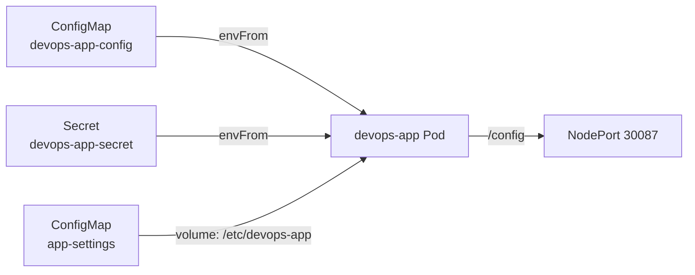

# B07 — ConfigMap ve Secret

| Profil / Araçlar | Açık Portlar |
|---|---|
| `kubectl`, `docker`, `kind`, `devops-app` (Node.js 24), `curl` | 30087 (NodePort) |

## Amaç

- Ayarları ConfigMap, gizli değerleri Secret ile vermek.
- Değerleri ortam değişkeni ve dosya olarak aktarmak.
- Ayar değişikliğinin Pod'a ne zaman yansıdığını görmek.

## Ön Koşullar

- B06 tamamlanmış olmalıdır.
- Sunucuda `30087` portu Kind tarafından dinleniyor olmalıdır (`kind-cluster.yaml`).
- İsteğe bağlı bölüm için Docker LAB-07'deki Docker Hub hesabı ve `devops-app-private` repository'si kullanılır.

## Mimari ve Çalışma Modeli

Aynı imaj; test, eğitim ve üretim ortamlarında yalnızca dışarıdan verilen ayarlarla farklı çalışır. Bu labda `devops-app` uygulaması ayarları iki yoldan alır:



| Aktarım | Değişiklik Pod'a ne zaman yansır |
|---|---|
| Ortam değişkeni (`envFrom`, `env`) | Yalnızca Pod yeniden oluşturulunca |
| Volume olarak bağlanan dosya | Kubelet tarafından kendiliğinden, yaklaşık bir dakika içinde |

Uygulamanın `/config` adresi ConfigMap'ten gelen mesajı ve Secret'ın yüklenip yüklenmediğini (`secretLoaded`) döndürür; Secret değerinin kendisini göstermez.

## Adım Adım Uygulama Rehberi

### 1. Namespace ve Imperative ConfigMap

```bash
cd ~/k8s-labs/beginner/lab-b07-configmap-secret
```

```bash
kubectl create namespace b07-config
```

Komut satırından anahtar-değer ile ConfigMap:

```bash
kubectl create configmap quick-config --from-literal=ENVIRONMENT=egitim --from-literal=MAX_CONNECTIONS=100 -n b07-config
```

Bir dosyanın tamamından ConfigMap. Dosya adı anahtar, içeriği değer olur:

```bash
cat starter/app.properties
```

```bash
kubectl create configmap app-settings --from-file=starter/app.properties -n b07-config
```

```bash
kubectl get configmap app-settings -n b07-config -o yaml
```

### 2. Declarative ConfigMap ve Secret

```bash
cat starter/configmap.yaml starter/secret.yaml
```

```bash
kubectl apply -f starter/configmap.yaml -f starter/secret.yaml -n b07-config
```

```bash
kubectl get configmap,secret -n b07-config
```

### 3. Secret Değerlerini İnceleme

`describe` değerleri göstermez, yalnızca boyutunu yazar:

```bash
kubectl describe secret devops-app-secret -n b07-config
```

API'de değer base64 ile kodlanmış olarak saklanır:

```bash
kubectl get secret devops-app-secret -n b07-config -o jsonpath='{.data.APP_API_KEY}{"\n"}'
```

Base64 bir şifreleme değildir; Secret'ı okuma yetkisi olan herkes değeri geri çözebilir:

```bash
kubectl get secret devops-app-secret -n b07-config -o jsonpath='{.data.APP_API_KEY}' | base64 -d; echo
```

Bu yüzden Secret okuma yetkisi sınırlı tutulur (I06) ve gerçek parolalar Git'e yazılmaz.

### 4. Uygulama İmajını Derleme ve Kind'e Yükleme

Uygulamanın kaynak kodu `app/devops-app` dizinindedir:

```bash
cat ~/k8s-labs/app/devops-app/Dockerfile
```

```bash
docker build -t devops-app:1.0 ~/k8s-labs/app/devops-app
```

Kind node'ları sunucunun Docker imajlarını görmez. `kind load`, imajı registry'ye göndermeden node'lara kopyalar:

```bash
kind load docker-image devops-app:1.0 --name k8s-labs
```

Kind node'ları birer Docker container'ıdır; adlarını görün:

```bash
kind get nodes --name k8s-labs
```

İmajın node'a geldiğini kontrol edin. `docker exec` node container'ında tek bir komut çalıştırır, shell açmaz. `crictl images` node'daki container runtime'ın (containerd) image listesini gösterir:

```bash
docker exec k8s-labs-worker crictl images | grep devops-app
```

`docker.io/library/devops-app   1.0` satırı görünür. Kubernetes bu imajı registry'den çekmeden node'dan kullanır.

### 5. Uygulamayı Ayarlarla Başlatma

```bash
cat starter/deployment.yaml
```

```bash
kubectl apply -f starter/deployment.yaml -f starter/service.yaml -n b07-config
```

```bash
kubectl get pods -n b07-config
```

İki Pod da `Running` olmalıdır. `STATUS` sütununda `ContainerCreating` görürseniz birkaç saniye sonra komutu tekrar çalıştırın.

ConfigMap mesajı ve Secret'ın yüklendiği uygulamanın cevabında görünür:

```bash
curl -s --retry 5 --retry-all-errors --retry-delay 2 http://127.0.0.1:30087/config; echo
```

```bash
curl -s http://127.0.0.1:30087/healthz; echo
```

Container içindeki ortam değişkenleri ve bağlanan dosya:

```bash
kubectl exec deploy/devops-app -n b07-config -- printenv APP_MESSAGE APP_VERSION
```

```bash
kubectl exec deploy/devops-app -n b07-config -- cat /etc/devops-app/app.properties
```

### 6. Ayarları Değiştirme

İki ConfigMap'i de değiştirin:

```bash
kubectl patch configmap devops-app-config -n b07-config --type merge -p '{"data":{"APP_MESSAGE":"ConfigMap guncellendi"}}'
```

```bash
kubectl patch configmap app-settings -n b07-config --type merge -p '{"data":{"app.properties":"log.level=debug\nfeature.new-ui=true\ncache.ttl.seconds=60\n"}}'
```

Ortam değişkeni Pod başlarken okunduğu için uygulama hâlâ eski mesajı döndürür:

```bash
curl -s http://127.0.0.1:30087/config; echo
```

Dosya ise kendiliğinden güncellenir. Aşağıdaki komut değişiklik gelene kadar bekler (en fazla iki dakika):

```bash
timeout 120 sh -c 'until kubectl exec deploy/devops-app -n b07-config -- grep -q debug /etc/devops-app/app.properties; do sleep 5; done' && echo "dosya guncellendi"
```

```bash
kubectl exec deploy/devops-app -n b07-config -- cat /etc/devops-app/app.properties
```

Ortam değişkenlerinin de güncellenmesi için Pod'ları yeniden oluşturun:

```bash
kubectl rollout restart deployment/devops-app -n b07-config
```

`rollout restart` Pod'ları birer birer yeniden oluşturur. `rollout status` yeni Pod'lar hazır olana kadar bekler; beklemeden sorgularsanız cevap kapanmakta olan eski bir Pod'dan gelebilir:

```bash
kubectl rollout status deployment/devops-app -n b07-config --timeout=120s
```

Yeni Pod'lar yeni değeri okudu:

```bash
kubectl exec deploy/devops-app -n b07-config -- printenv APP_MESSAGE
```

Eski Pod'lar kapanırken birkaç saniye boyunca eski cevap gelebilir. Kısa bir bekleme sonrası uygulamayı tekrar sorgulayın:

```bash
sleep 5; curl -s http://127.0.0.1:30087/config; echo
```

<details><summary><strong>7. İsteğe Bağlı: Private Registry ve imagePullSecrets</strong></summary>

Bu bölüm Docker LAB-07'de açtığınız Docker Hub hesabını, okuma-yazma yetkili token'ı ve `devops-app-private` repository'sini kullanır; yeni repository açmanız gerekmez. LAB-07'yi yapmadıysanız Docker Hub'da `devops-app-private` adında **Private** bir repository ve **Account Settings → Personal access tokens** bölümünden okuma-yazma yetkili bir token oluşturun.

```text
export DOCKERHUB_USERNAME="<DOCKERHUB_KULLANICI_ADINIZ>"
export PRIVATE_IMAGE="docker.io/${DOCKERHUB_USERNAME}/devops-app-private:1.0"
```

İmajı aynı repository'ye `1.0` etiketiyle gönderin; LAB-07'deki `1.0.0` etiketine dokunulmaz. Şifre sorulduğunda token'ı yapıştırın:

```text
docker login -u "$DOCKERHUB_USERNAME"
docker tag devops-app:1.0 "$PRIVATE_IMAGE"
docker push "$PRIVATE_IMAGE"
```

Kimlik bilgisi vermeden Pod oluşturun:

```text
sed "s|__PRIVATE_IMAGE__|${PRIVATE_IMAGE}|" starter/private-pod.yaml | kubectl apply -n b07-config -f -
kubectl get pod private-app -n b07-config
kubectl describe pod private-app -n b07-config | grep -i "failed to pull"
```

Pod `ErrImagePull` ve ardından `ImagePullBackOff` durumuna düşer; hata mesajında `pull access denied ... authorization failed` görünür.

Token'ı komut geçmişine yazmadan registry Secret'ı oluşturun ve Pod'u Secret ile yeniden başlatın:

```text
read -rsp "Docker Hub token: " DOCKERHUB_TOKEN; echo
kubectl create secret docker-registry dockerhub-cred -n b07-config \
  --docker-server=https://index.docker.io/v1/ \
  --docker-username="$DOCKERHUB_USERNAME" \
  --docker-password="$DOCKERHUB_TOKEN"
unset DOCKERHUB_TOKEN
kubectl delete pod private-app -n b07-config
sed "s|__PRIVATE_IMAGE__|${PRIVATE_IMAGE}|" starter/private-pod-with-secret.yaml | kubectl apply -n b07-config -f -
kubectl get pod private-app -n b07-config
```

Pod `Running` olur: kubelet imajı `dockerhub-cred` içindeki kimlikle çekti. İş bitince sunucudaki Docker oturumunu kapatın:

```text
docker logout
```

</details>

## Temizlik

```bash
kubectl delete namespace b07-config
```

`devops-app:1.0` imajı sonraki lablarda da kullanıldığı için sunucuda ve Kind node'larında bırakılır. Tüm lablar bittiğinde silmek için:

```text
docker rmi devops-app:1.0
```
