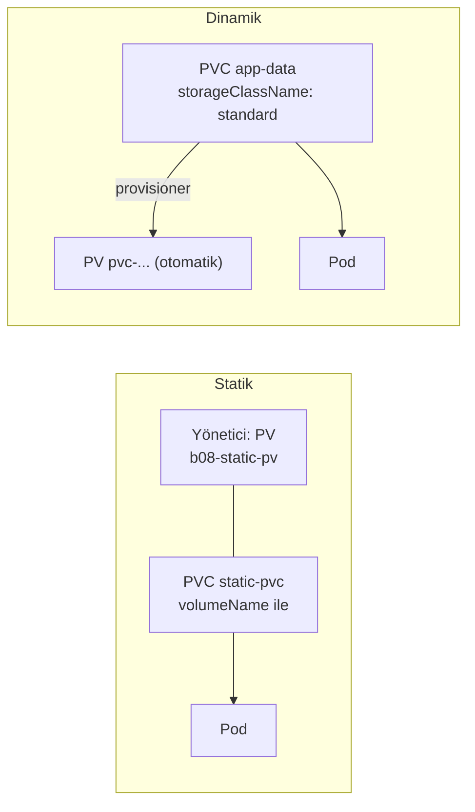
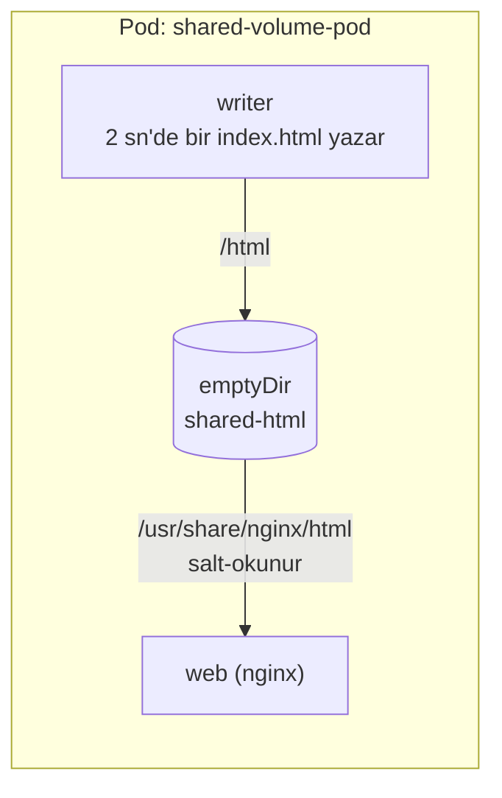
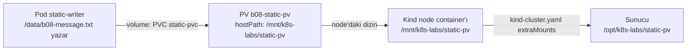

# B08 — Depolama: emptyDir, PV ve PVC

| Profil / Araçlar | Açık Portlar |
|---|---|
| `kubectl`, `alpine:3.24`, `busybox:1.37`, `nginx:1.30-alpine`, StorageClass `standard` | — |

## Amaç

- `emptyDir` ile kalıcı disk farkını görmek.
- Statik PV ve dinamik PVC kullanmak.
- Pod silinse de verinin korunduğunu kanıtlamak.

## Ön Koşullar

- B07 tamamlanmış olmalıdır.
- Sunucuda `/opt/k8s-labs/static-pv` dizini bulunmalı ve cluster `kind-cluster.yaml` ile oluşturulmuş olmalıdır. Bu dosya dizini tüm node'lara `/mnt/k8s-labs/static-pv` olarak bağlar.

## Mimari ve Çalışma Modeli



| Kavram | Görevi |
|---|---|
| `emptyDir` | Pod ile birlikte oluşur ve silinir; Pod'daki container'lar arasında dosya paylaşımı |
| PersistentVolume (PV) | Cluster'daki gerçek bir disk; cluster düzeyinde nesne |
| PersistentVolumeClaim (PVC) | Uygulamanın belirli boyut ve erişim modunda disk talebi; namespace düzeyinde |
| StorageClass | PVC açıldığında PV'yi otomatik oluşturan provisioner'ı seçer |

Kind'deki `standard` StorageClass, veriyi Pod'un çalıştığı node'un diskine yazar ve `WaitForFirstConsumer` modundadır: disk, PVC'yi kullanan ilk Pod bir node'a yerleşince açılır.

## Adım Adım Uygulama Rehberi

### 1. Namespace

```bash
cd ~/k8s-labs/beginner/lab-b08-storage
```

```bash
kubectl create namespace b08-storage
```

### 2. emptyDir: Pod İçinde Geçici Paylaşım



`writer` her iki saniyede bir sayfayı ortak diske yazar, `web` aynı diski salt-okunur bağlayıp sunar.

`emptyDir` nerede durur? Pod bir node'a yerleşince kubelet o node'un diskinde Pod'a özel boş bir klasör açar ve Pod'daki container'lara bağlar. Klasörün ömrü Pod'un ömrüdür: container çökse ve yeniden başlasa da klasör kalır, Pod silinince kubelet klasörü de siler. Bu yüzden container'lar arasında dosya paylaşmak için uygundur, kalıcı veri için değil.

```bash
cat starter/pod-emptydir.yaml
```

```bash
kubectl apply -f starter/pod-emptydir.yaml -n b08-storage
```

```bash
kubectl get pod shared-volume-pod -n b08-storage
```

`READY` sütunu `2/2` olmalıdır: iki container da çalışıyor. `ContainerCreating` görürseniz image hâlâ iniyordur; birkaç saniye sonra komutu tekrar çalıştırın.

`web` container'ından sayfayı isteyin. Sayfayı `writer` yazdı, `web` sunuyor:

```bash
kubectl exec shared-volume-pod -c web -n b08-storage -- wget -qO- http://localhost
```

Komutu birkaç saniye sonra tekrar çalıştırın; saat değişir. `writer` dosyayı her iki saniyede güncelliyor ve `web` aynı diski okuyor.

Bu klasörü node'un diskinde görün. Pod'un hangi node'da olduğunu ve kimliğini (UID) alın; `docker exec` node container'ında tek bir komut çalıştırır:

```bash
NODE=$(kubectl get pod shared-volume-pod -n b08-storage -o jsonpath='{.spec.nodeName}')
POD_UID=$(kubectl get pod shared-volume-pod -n b08-storage -o jsonpath='{.metadata.uid}')
echo "$NODE $POD_UID"
```

```bash
docker exec "$NODE" ls -l /var/lib/kubelet/pods/$POD_UID/volumes/kubernetes.io~empty-dir/shared-html
```

`index.html` dosyası görünür: `emptyDir`, node'un diskinde Pod'a ait bir klasördür.

Pod'u silin. `emptyDir` ve içindeki sayfa da silinir; aynı Pod yeniden oluşturulsa disk boş başlar. `writer` döngüsü kapatma sinyalini (SIGTERM) dinlemez; Kubernetes böyle bir container'ı 30 saniye bekleyip zorla kapatır. `--now` bu bekleme süresini 1 saniyeye indirir:

```bash
kubectl delete pod shared-volume-pod -n b08-storage --now
```

Pod'un klasörü de silindi; komut `No such file or directory` yazar:

```bash
docker exec "$NODE" ls /var/lib/kubelet/pods/$POD_UID
```

### 3. Statik PV ve PVC

Yönetici diski önceden tanımlar; PVC `volumeName` ile bu diski ister. Pod'un yazdığı dosyanın nereye gittiğini aşağıdaki zincir gösterir:



1. Pod'un manifestinde `/data` dizini `static-pvc` adlı PVC'ye bağlanır.
2. PVC, `b08-static-pv` adlı PV'ye bağlıdır. Bu PV `hostPath` türündedir: diski, Pod'un çalıştığı node'daki `/mnt/k8s-labs/static-pv` dizinidir.
3. Kind node'ları birer Docker container'ıdır. `kind-cluster.yaml` içindeki `extraMounts`, sunucunun `/opt/k8s-labs/static-pv` dizinini her node'a `/mnt/k8s-labs/static-pv` olarak bağlar.

Sonuç: Pod `/data`'ya yazdığında dosya aslında sunucunun `/opt/k8s-labs/static-pv` dizinine düşer; bu yüzden aşağıda sunucuda `cat` ile okuyabiliyoruz. Gerçek cluster'larda PV genellikle bir ağ diski ya da bulut diskidir (NFS, EBS ...) ve içine Pod üzerinden (`kubectl exec`) bakılır. `hostPath` node'a bağımlı olduğu için yalnızca lab ve test ortamlarında kullanılır.

```bash
cat starter/static-pv-pvc.yaml
```

- `hostPath: /mnt/k8s-labs/static-pv`: PV'nin diski, node'a bağlanan sunucu dizinidir (`/opt/k8s-labs/static-pv`).
- `persistentVolumeReclaimPolicy: Retain`: PVC silinse de PV ve sunucudaki veri silinmez.
- `storageClassName: ""`: StorageClass yok demektir; Kubernetes bu PVC için otomatik disk açmaz.
- `volumeName: b08-static-pv`: PVC'yi doğrudan bu PV'ye bağlar.

```bash
kubectl apply -f starter/static-pv-pvc.yaml -n b08-storage
```

PV cluster düzeyindedir (`-n` almaz), PVC namespace içindedir. İkisi de `Bound` olur:

```bash
kubectl get pv b08-static-pv
```

```bash
kubectl get pvc static-pvc -n b08-storage
```

Diske yazan bir Pod çalıştırın:

```bash
kubectl apply -f starter/static-writer.yaml -n b08-storage
```

Pod dosyayı yazıp kapanır; işi bittiği için `STATUS` `Completed` olur:

```bash
kubectl get pod static-writer -n b08-storage
```

`ContainerCreating` görürseniz image hâlâ iniyordur; birkaç saniye sonra komutu tekrar çalıştırın. Pod'un çıktısı yazdığı satırdır:

```bash
kubectl logs static-writer -n b08-storage
```

Pod `/data/b08-message.txt` dosyasına yazdı; aynı dosya yukarıdaki zincir sayesinde sunucunun diskinde duruyor:

```bash
cat /opt/k8s-labs/static-pv/b08-message.txt
```

Yazan Pod'u silin ve aynı PVC'yi bağlayan başka bir Pod ile okuyun:

```bash
kubectl delete pod static-writer -n b08-storage
```

```bash
kubectl apply -f starter/static-reader.yaml -n b08-storage
```

```bash
kubectl get pod static-reader -n b08-storage
```

`Completed` olduktan sonra okuduğu satıra bakın; `static-writer`'ın yazdığı satırın aynısıdır:

```bash
kubectl logs static-reader -n b08-storage
```

### 4. Dinamik PVC

Cluster'daki StorageClass'lar:

```bash
kubectl get storageclass
```

`standard (default)`: PVC'de StorageClass yazılmazsa bu kullanılır. `PROVISIONER` diski açan bileşendir, `RECLAIMPOLICY` `Delete`, `VOLUMEBINDINGMODE` `WaitForFirstConsumer`'dır.

PVC'yi oluşturun. Henüz onu kullanan Pod olmadığı için `Pending` kalır:

```bash
kubectl apply -f starter/dynamic-pvc.yaml -n b08-storage
```

```bash
kubectl get pvc app-data -n b08-storage
```

Nedenini PVC'nin olaylarında görün; son satırda `waiting for first consumer to be created before binding` yazar:

```bash
kubectl describe pvc app-data -n b08-storage | tail -n 3
```

PVC'yi kullanan Pod'u başlatın; PV otomatik oluşur ve PVC `Bound` olur:

```bash
kubectl apply -f starter/data-pod-1.yaml -n b08-storage
```

`NODE` sütunu Pod'un yerleştiği node'dur; disk bu node'da açılır:

```bash
kubectl get pod data-pod-1 -n b08-storage -o wide
```

`ContainerCreating` görürseniz image hâlâ iniyordur; birkaç saniye sonra komutu tekrar çalıştırın. PVC artık `Bound`:

```bash
kubectl get pvc app-data -n b08-storage
```

Provisioner'ın açtığı PV. `pvc-` ile başlayan adı otomatik verildi, politikası `Delete`:

```bash
kubectl get pv -o custom-columns='NAME:.metadata.name,CLAIM:.spec.claimRef.name,POLICY:.spec.persistentVolumeReclaimPolicy,STATUS:.status.phase'
```

Bu dinamik diskin içi sunucuda doğrudan görünmez; `standard` StorageClass onu Pod'un node'undaki `/var/local-path-provisioner` dizini altında açar. İçine Pod üzerinden bakılır.

Kalıcı diske veri yazın:

```bash
kubectl exec data-pod-1 -n b08-storage -- sh -c 'echo "kalici veri: $(date)" > /data/not.txt'
```

```bash
kubectl exec data-pod-1 -n b08-storage -- cat /data/not.txt
```

### 5. Pod Silinse de Veri Kalır

`data-pod-1` içinde yalnızca `sleep` çalışır; o da sinyali dinlemediği için `--now` ile silin:

```bash
kubectl delete pod data-pod-1 -n b08-storage --now
```

Pod silindi ama PVC ve disk duruyor; PVC hâlâ `Bound`:

```bash
kubectl get pvc app-data -n b08-storage
```

Aynı PVC'yi bağlayan yeni bir Pod başlatın:

```bash
kubectl apply -f starter/data-pod-2.yaml -n b08-storage
```

```bash
kubectl get pod data-pod-2 -n b08-storage -o wide
```

`NODE` sütunu `data-pod-1` ile aynıdır: `standard` StorageClass diski bir node'un üzerinde açar, bu yüzden diski kullanan her Pod o node'a yerleşir. `ContainerCreating` görürseniz image hâlâ iniyordur; birkaç saniye sonra komutu tekrar çalıştırın.

```bash
kubectl exec data-pod-2 -n b08-storage -- cat /data/not.txt
```

Önceki Pod'un yazdığı veri yeni Pod'da duruyor.

## Temizlik

Önce çalışan Pod'ları beklemeden kapatın; yoksa namespace ve PV silme, Pod'ların 30 saniyelik kapanma süresini bekler:

```bash
kubectl delete pod --all -n b08-storage --now
```

Namespace silinince dinamik PVC ve ona bağlı PV (`Delete` politikası) silinir:

```bash
kubectl delete namespace b08-storage
```

Statik PV'yi ve sunucudaki veriyi elle silin:

```bash
kubectl delete pv b08-static-pv
```

```bash
rm -f /opt/k8s-labs/static-pv/b08-message.txt
```
