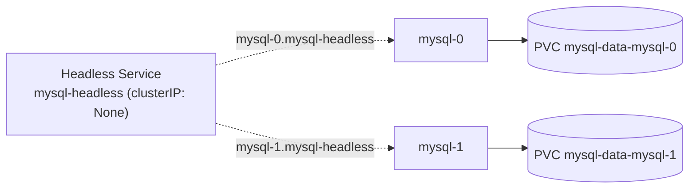

# B09 — StatefulSet ve MySQL

| Profil / Araçlar | Açık Portlar |
|---|---|
| `kubectl`, `mysql:8.4`, StorageClass `standard` | — |

## Amaç

- MySQL'i StatefulSet ile çalıştırmak.
- Sabit Pod adlarını ve Pod başına diski görmek.
- Pod silinince verinin korunduğunu kanıtlamak.

## Ön Koşullar

- B08 tamamlanmış olmalıdır.

## Mimari ve Çalışma Modeli

Deployment Pod'ları birbirinin aynısıdır: adları rastgele, sıraları önemsiz, PVC'leri ortaktır. Bir veritabanı ise her replica için sabit bir kimlik ve kendine ait bir disk ister.



| Özellik | Deployment | StatefulSet |
|---|---|---|
| Pod adı | `web-6c96...-x7k2p` (rastgele) | `mysql-0`, `mysql-1` (sabit, sıralı) |
| Başlatma | Hepsi aynı anda | Sırayla; bir önceki hazır olmadan sonraki başlamaz |
| Disk | Şablondaki PVC'yi tüm Pod'lar paylaşır | Her Pod'a `volumeClaimTemplates` ile ayrı PVC |
| Pod silinince | Farklı adla yenisi gelir | Aynı adla gelir, aynı PVC'yi bağlar |

Bu lab, StatefulSet'in kimlik ve disk davranışını gösterir. İki MySQL replica'sı birbirinden bağımsızdır; aralarında veri replikasyonu kurulmaz.

## Adım Adım Uygulama Rehberi

### 1. Namespace ve Secret

```bash
cd ~/k8s-labs/beginner/lab-b09-statefulset-mysql
```

```bash
kubectl create namespace b09-db
```

Root parolası Secret'ta base64 ile tutulur:

```bash
cat starter/secret.yaml
```

```bash
kubectl apply -f starter/secret.yaml -n b09-db
```

### 2. StatefulSet ve Headless Service

```bash
cat starter/mysql-statefulset.yaml
```

```bash
kubectl apply -f starter/mysql-statefulset.yaml -n b09-db
```

Pod'ları hemen listeleyin:

```bash
kubectl get pods -n b09-db -l app=mysql
```

Önce yalnızca `mysql-0` vardır (`Pending` ya da `ContainerCreating`). StatefulSet Pod'ları sırayla açar: `mysql-0` hazır (`READY 1/1`) olmadan `mysql-1`'i oluşturmaz. MySQL ilk açılışta veri dizinini hazırladığı için bu bir dakika kadar sürebilir. Komutu birkaç saniye arayla tekrar çalıştırıp sırayı izleyin; iki Pod da `1/1 Running` olunca devam edin.

Pod'ların yerleştiği node'lar:

```bash
kubectl get pods -n b09-db -l app=mysql -o wide
```

### 3. Her Pod'a Ayrı Disk

```bash
kubectl get pvc -n b09-db
```

`mysql-data-mysql-0` ve `mysql-data-mysql-1` adlı iki ayrı PVC oluşmuştur: şablon adı + Pod adı.

### 4. Headless Service ile Pod DNS Adları

Headless Service'in sanal IP'si yoktur:

```bash
kubectl get service mysql-headless -n b09-db
```

Her Pod `<pod>.<servis>` adıyla bulunabilir. `mysql-1` içinden `mysql-0`'ı çözün:

```bash
kubectl exec mysql-1 -n b09-db -- getent hosts mysql-0.mysql-headless
```

Uygulamalar, örneğin her zaman birincil replica'ya yazmak için, bu sabit adları kullanır.

### 5. Veri Yazma

Komut Pod içinde çalışır ve parolayı Pod'un ortam değişkeninden okur; parola sunucunun terminaline veya komut geçmişine düşmez:

```bash
kubectl exec mysql-0 -n b09-db -- sh -c 'MYSQL_PWD="$MYSQL_ROOT_PASSWORD" mysql -uroot devops_db -e "
CREATE TABLE kullanicilar (id INT AUTO_INCREMENT PRIMARY KEY, ad VARCHAR(50), puan INT);
INSERT INTO kullanicilar (ad, puan) VALUES (\"Ayse\", 95), (\"Mehmet\", 88);"'
```

```bash
kubectl exec mysql-0 -n b09-db -- sh -c 'MYSQL_PWD="$MYSQL_ROOT_PASSWORD" mysql -uroot devops_db -e "SELECT * FROM kullanicilar;"'
```

`mysql-1` ayrı bir veritabanıdır; bu tablo orada yoktur:

```bash
kubectl exec mysql-1 -n b09-db -- sh -c 'MYSQL_PWD="$MYSQL_ROOT_PASSWORD" mysql -uroot devops_db -e "SHOW TABLES;"'
```

### 6. Pod Silinince Kimlik ve Veri Korunur

```bash
kubectl delete pod mysql-0 -n b09-db
```

```bash
kubectl get pods -n b09-db -l app=mysql
```

StatefulSet silinen Pod'un yerine aynı adla, yine `mysql-0` adıyla yeni bir Pod açar; `AGE` sütunu birkaç saniyedir. `READY 1/1` olana kadar komutu tekrar çalıştırın.

Yeni Pod aynı PVC'yi bağladı. Silmeden önce eklediğiniz kayıtlar yerinde:

```bash
kubectl exec mysql-0 -n b09-db -- sh -c 'MYSQL_PWD="$MYSQL_ROOT_PASSWORD" mysql -uroot devops_db -e "SELECT * FROM kullanicilar;"'
```

`Ayse` ve `Mehmet` satırları 5. adımdakiyle aynıdır.

### 7. Küçültme ve Büyütme

StatefulSet küçültülünce en yüksek numaralı Pod silinir:

```bash
kubectl scale statefulset/mysql --replicas=1 -n b09-db
```

```bash
kubectl get pods,pvc -n b09-db
```

`mysql-1` önce `Terminating` olur, birkaç saniye sonra listeden çıkar; komutu tekrar çalıştırıp görün. İki PVC de yerindedir: `mysql-1`'in verisi, StatefulSet tekrar büyütülünce geri bağlanmak üzere bekler.

```bash
kubectl scale statefulset/mysql --replicas=2 -n b09-db
```

```bash
kubectl get pods,pvc -n b09-db
```

`mysql-1` aynı adla yeniden oluşur ve yeni bir PVC açılmaz; eski `mysql-data-mysql-1` PVC'sine bağlanır. `READY 1/1` olana kadar komutu tekrar çalıştırın.

## Temizlik

StatefulSet silinse de PVC'ler veri güvenliği için kendiliğinden silinmez. Namespace'i silmek PVC'leri ve dinamik PV'leri de siler:

```bash
kubectl delete namespace b09-db
```
