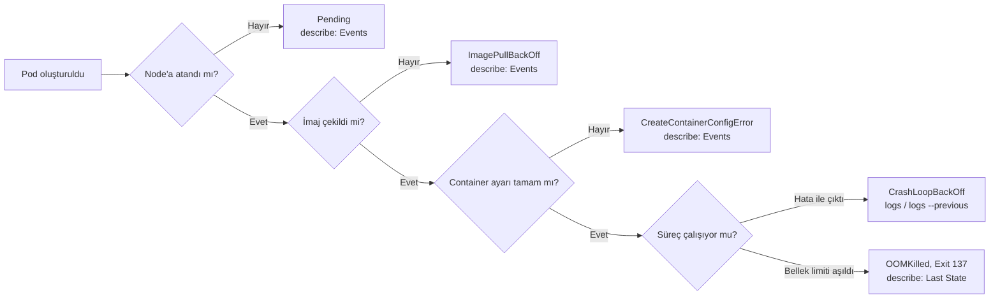

# B10 — Pod Sorun Giderme

| Profil / Araçlar | Açık Portlar |
|---|---|
| `kubectl`, `busybox:1.37`, `nginx:1.30-alpine` | — |

## Amaç

- Beş yaygın Pod hatasını oluşturup düzeltmek.
- Doğru teşhis komutunu seçmek: `describe`, `logs`, Events.

## Ön Koşullar

- B09 tamamlanmış olmalıdır.

## Mimari ve Çalışma Modeli

Bir Pod çalışmadığında hatanın hangi aşamada olduğu, nereye bakılacağını belirler:



| Durum | Anlamı | İlk komut |
|---|---|---|
| `Pending` | Scheduler Pod'u hiçbir node'a yerleştiremedi | `kubectl describe pod` → Events |
| `ImagePullBackOff` | İmaj adı/tag yanlış, imaj yok veya registry yetkisi yok | `kubectl describe pod` → Events |
| `CreateContainerConfigError` | Pod'un istediği ConfigMap veya Secret yok | `kubectl describe pod` → Events |
| `CrashLoopBackOff` | Container başlıyor ve hata ile çıkıyor; Kubernetes artan aralıklarla yeniden başlatıyor | `kubectl logs`, gerekirse `--previous` |
| `OOMKilled` | Container bellek limitini aştı, kernel süreci öldürdü (`137` = 128 + SIGKILL 9) | `kubectl describe pod` → Last State |

## Adım Adım Uygulama Rehberi

### 1. Namespace

```bash
cd ~/k8s-labs/beginner/lab-b10-pod-troubleshooting
```

```bash
kubectl create namespace b10-debug
```

### 2. CrashLoopBackOff

Uygulama `DB_HOST` ayarı boş olduğu için başlar başlamaz `exit 1` ile kapanır:

```bash
cat starter/crash-pod.yaml
```

```bash
kubectl apply -f starter/crash-pod.yaml -n b10-debug
```

Kubernetes container'ı yeniden başlatır; her başarısızlıkta bekleme süresi artar (10 sn, 20 sn, 40 sn ... en fazla 5 dk). Durumu görün:

```bash
kubectl get pod crash-demo -n b10-debug
```

Komutu birkaç kez, aralarda biraz bekleyerek çalıştırın: `STATUS` `Error` ile `CrashLoopBackOff` arasında değişir, `RESTARTS` sayısı artar. `describe` çıktısında `Last State: Terminated`, `Exit Code: 1` görünür:

```bash
kubectl describe pod crash-demo -n b10-debug | grep -A4 'Last State'
```

Container bekleme süresindeyken `kubectl logs` son çöken çalışmanın logunu gösterir ve nedeni ortaya çıkarır:

```bash
kubectl logs crash-demo -n b10-debug
```

Container yeniden başlamış ve o an çalışıyorsa `kubectl logs` yeni çalışmanın logunu verir. Bu durumda çöken bir önceki çalışmanın logu `kubectl logs <pod> --previous` ile okunur.

Düzeltilmiş tanımla Pod'u yeniden oluşturun. Pod'un çoğu alanı değiştirilemez; `replace --force` Pod'u silip yeniden yaratır:

```bash
kubectl replace --force -f starter/crash-fixed-pod.yaml -n b10-debug
```

Sorun çözüldü: `STATUS` `Running`, `RESTARTS` `0`:

```bash
kubectl get pod crash-demo -n b10-debug
```

```bash
kubectl logs crash-demo -n b10-debug
```

### 3. OOMKilled

Uygulama açılışta 100 MB'lık önbellek hazırlar ama bellek limiti 32 Mi'dir:

```bash
cat starter/oom-pod.yaml
```

```bash
kubectl apply -f starter/oom-pod.yaml -n b10-debug
```

```bash
kubectl get pod oom-demo -n b10-debug
```

`STATUS` `OOMKilled` olur; `ContainerCreating` görürseniz birkaç saniye sonra tekrar çalıştırın. Kubernetes container'ı yeniden başlattıkça durum `CrashLoopBackOff`'a da döner ve `RESTARTS` artar.

```bash
kubectl describe pod oom-demo -n b10-debug | grep -A5 'State:'
```

`Reason: OOMKilled` ve `Exit Code: 137` görünür. Bu bir kod hatası değil, bellek limiti aşımıdır; uygulama logunda hata yazmaz, süreç kernel tarafından aniden öldürülür. Çözüm, uygulamanın gerçek ihtiyacına göre limiti belirlemektir:

```bash
kubectl replace --force -f starter/oom-fixed-pod.yaml -n b10-debug
```

Sorun çözüldü: `STATUS` `Running`, `RESTARTS` `0`:

```bash
kubectl get pod oom-demo -n b10-debug
```

```bash
kubectl logs oom-demo -n b10-debug
```

### 4. ImagePullBackOff

İmaj etiketinde yazım hatası var (`alpinee`):

```bash
kubectl apply -f starter/image-pod.yaml -n b10-debug
```

```bash
kubectl get pod image-demo -n b10-debug
```

`STATUS` önce `ErrImagePull`, ardından `ImagePullBackOff` olur; görmediyseniz birkaç saniye sonra tekrar çalıştırın.

```bash
kubectl describe pod image-demo -n b10-debug | grep -i 'failed to pull' | head -1
```

Mesajda imajın bulunamadığı (`not found`) yazar. Private bir imajda aynı durum `authorization failed` mesajıyla görülür (B07). Container imajı, Pod'da değiştirilebilen az sayıdaki alandan biridir:

```bash
kubectl set image pod/image-demo web=nginx:1.30-alpine -n b10-debug
```

İmaj değişti:

```bash
kubectl describe pod image-demo -n b10-debug | grep 'Image:'
```

Sorun çözüldü: `STATUS` `Running`. Yeni imaj inerken `ContainerCreating` görürseniz komutu tekrar çalıştırın:

```bash
kubectl get pod image-demo -n b10-debug
```

### 5. Pending

Pod 64 CPU çekirdeği istiyor; cluster'daki hiçbir node'da bu kadar boş kaynak yok:

```bash
kubectl apply -f starter/pending-pod.yaml -n b10-debug
```

```bash
kubectl get pod pending-demo -n b10-debug -o wide
```

`NODE` sütunu `<none>`: Pod hiçbir node'a atanmadı. Nedeni scheduler'ın olay kaydındadır:

```bash
kubectl describe pod pending-demo -n b10-debug | grep -A3 Events
```

`Insufficient cpu` mesajı görünür. Node'ların kapasitesini kontrol edin:

```bash
kubectl describe node k8s-labs-worker | grep -A6 'Allocatable'
```

İsteği gerçekçi bir değere indirin:

```bash
sed 's/cpu: "64"/cpu: 100m/' starter/pending-pod.yaml | kubectl replace --force -f - -n b10-debug
```

Sorun çözüldü: `NODE` sütununda bir node adı var ve `STATUS` `Running`:

```bash
kubectl get pod pending-demo -n b10-debug -o wide
```

`Pending` başka nedenlerle de oluşur: bağlanamayan PVC, uygun olmayan `nodeSelector` veya taint. Hepsinde ilk bakılacak yer Events bölümüdür.

### 6. CreateContainerConfigError

Pod, olmayan bir ConfigMap'i istiyor:

```bash
kubectl apply -f starter/config-pod.yaml -n b10-debug
```

```bash
kubectl get pod config-demo -n b10-debug
```

`STATUS` `CreateContainerConfigError` olur; `ContainerCreating` görürseniz birkaç saniye sonra tekrar çalıştırın.

```bash
kubectl describe pod config-demo -n b10-debug | grep -i 'not found' | head -1
```

Eksik ConfigMap'i oluşturun. Kubelet tekrar dener ve Pod kendiliğinden başlar; Pod'u yeniden oluşturmak gerekmez:

```bash
kubectl create configmap web-settings --from-literal=MODE=egitim -n b10-debug
```

Sorun çözüldü: `STATUS` `Running`. Kubelet birkaç saniyede bir tekrar dener; hâlâ hata görüyorsanız komutu tekrar çalıştırın:

```bash
kubectl get pod config-demo -n b10-debug
```

### 7. Namespace'teki Uyarıları Toplu Görme

Bir namespace'te ne olup bittiğini görmenin en hızlı yolu uyarı olaylarıdır:

```bash
kubectl get events -n b10-debug --field-selector type=Warning --sort-by=.lastTimestamp | tail -15
```

## Doğal Doğrulama ve Beklenen Sonuç

```bash
kubectl get pods -n b10-debug --no-headers -o custom-columns='NAME:.metadata.name,STATUS:.status.phase' | sort
```

```bash
kubectl logs oom-demo -n b10-debug | tail -1
```

Beklenen sonuç: beş Pod'un da sorunu giderilmiş ve hepsi çalışıyor; düzeltilen uygulama önbelleği hazırlamış.

```text
config-demo    Running
crash-demo     Running
image-demo     Running
oom-demo       Running
pending-demo   Running
hazir
```

## Temizlik

```bash
kubectl delete namespace b10-debug
```
