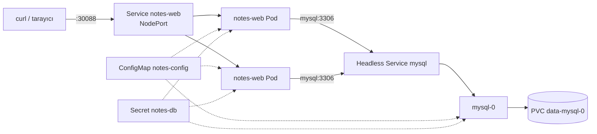

# B11 — Capstone: Veritabanlı Uygulamayı Uçtan Uca Dağıtma

| Profil / Araçlar | Açık Portlar |
|---|---|
| `kubectl`, `docker`, `kind`, `notes-app` (Node.js 24), `mysql:8.4`, `curl` | 30088 (NodePort) |

## Amaç

- Veritabanlı bir uygulamayı Beginner konularıyla uçtan uca dağıtmak.
- Veritabanı kapanınca trafiğin kesildiğini, açılınca döndüğünü görmek.
- Pod'lar silinse de verinin korunduğunu kanıtlamak.

## Ön Koşullar

- B01–B10 tamamlanmış olmalıdır.
- Sunucuda `30088` portu Kind tarafından dinleniyor olmalıdır (`kind-cluster.yaml`).

## Mimari ve Çalışma Modeli



`notes-app` küçük bir not defteri uygulamasıdır. Uygulama adresleri:

| Adres | Görevi |
|---|---|
| `GET /` | Notları HTML sayfa olarak gösterir |
| `GET /api/notes`, `POST /api/notes` | Notları listeler, yeni not ekler |
| `GET /healthz` | Süreç ayakta mı (liveness); veritabanına bakmaz |
| `GET /ready` | Veritabanına ulaşabiliyor mu (readiness); ulaşamazsa `503` döner |

Web Deployment'ında iki sağlık kontrolü (probe) tanımlıdır. **Readiness probe** başarısız olan Pod'u Service'ten çıkarır, böylece veritabanına ulaşamayan Pod'a trafik gitmez. **Liveness probe** kilitlenen container'ı yeniden başlatır. Probe'lar I03'te ayrıntılı anlatılır.

## Adım Adım Uygulama Rehberi

### 1. Namespace ve Uygulama İmajı

```bash
cd ~/k8s-labs/beginner/lab-b11-capstone
```

```bash
kubectl create namespace b11-capstone
```

```bash
docker build -t notes-app:1.0 ~/k8s-labs/app/notes-app
```

```bash
kind load docker-image notes-app:1.0 --name k8s-labs
```

İmajın node'a geldiğini kontrol edin (B07'deki gibi):

```bash
docker exec k8s-labs-worker crictl images | grep notes-app
```

### 2. Secret ve ConfigMap

```bash
cat starter/01-secret.yaml starter/02-configmap.yaml
```

```bash
kubectl apply -f starter/01-secret.yaml -f starter/02-configmap.yaml -n b11-capstone
```

### 3. Veritabanı Katmanı

MySQL, ConfigMap'teki veritabanı adını ve kullanıcıyı, Secret'taki parolaları kullanarak ilk açılışta `notesdb` veritabanını ve `notes` kullanıcısını oluşturur:

```bash
cat starter/03-mysql.yaml
```

```bash
kubectl apply -f starter/03-mysql.yaml -n b11-capstone
```

```bash
kubectl get pods,pvc -n b11-capstone
```

`mysql-0` önce `ContainerCreating`, sonra `Running` olur. MySQL ilk açılışta veritabanını hazırladığı için `READY` sütununun `1/1` olması bir dakika kadar sürebilir; komutu arada bir tekrar çalıştırın. PVC `data-mysql-0` `Bound` olur. Web katmanına `mysql-0` `1/1` olunca geçin.

### 4. Web Katmanı

```bash
cat starter/04-web.yaml
```

```bash
kubectl apply -f starter/04-web.yaml -n b11-capstone
```

```bash
kubectl get pods,service -n b11-capstone -o wide
```

İki `notes-web` Pod'u `1/1` olmalıdır: readiness probe veritabanına ulaşınca Pod hazır sayılır. `0/1` görürseniz birkaç saniye sonra tekrar çalıştırın. `notes-web` Service'i `80:30088/TCP` gösterir.

### 5. Uygulamayı Kullanma

Uygulama veritabanına bağlı:

```bash
curl -s --retry 5 --retry-all-errors --retry-delay 2 http://127.0.0.1:30088/ready; echo
```

İki not ekleyin:

```bash
curl -s -X POST -H 'Content-Type: application/json' -d '{"text":"Kubernetes capstone tamamlandi"}' http://127.0.0.1:30088/api/notes; echo
```

```bash
curl -s -X POST -H 'Content-Type: application/json' -d '{"text":"Veri MySQL PVC uzerinde"}' http://127.0.0.1:30088/api/notes; echo
```

```bash
curl -s http://127.0.0.1:30088/api/notes; echo
```

Sayfa ve cevap veren Pod. Birkaç kez çalıştırın; Service istekleri iki web Pod'una dağıtır:

```bash
for i in 1 2 3 4; do curl -s http://127.0.0.1:30088/ | grep -o 'Pod: [a-z0-9-]*'; done
```

Tarayıcıdan açacağınız adres (sunucunun firewall'unda `30088` açık olmalıdır):

```bash
echo "http://$(curl -s ifconfig.me):30088"
```

### 6. Veritabanı Kapanınca Ne Olur

Bakım senaryosu: veritabanını durdurun. StatefulSet'i sıfıra indirmek Pod'u siler ama PVC'yi ve veriyi korur:

```bash
kubectl scale statefulset/mysql --replicas=0 -n b11-capstone
```

```bash
kubectl get pods -n b11-capstone
```

`mysql-0` önce `Terminating` olur, sonra listeden çıkar. Readiness probe 5 saniyede bir `/ready` adresini sorar; iki kez başarısız olunca web Pod'ları `0/1` durumuna geçer. Bunu görene kadar komutu birkaç saniye arayla tekrar çalıştırın.

Pod'lar çalışıyor (`Running`) ama hazır değil; yeniden başlatılmıyorlar (`RESTARTS` artmıyor), çünkü liveness kontrolü veritabanına bakmaz. Service'in gönderebileceği hazır Pod kalmadı:

```bash
kubectl get endpointslice -n b11-capstone -l kubernetes.io/service-name=notes-web -o jsonpath='{range .items[*].endpoints[*]}{.targetRef.name} ready={.conditions.ready}{"\n"}{end}'
```

```bash
curl -s -m 3 http://127.0.0.1:30088/api/notes || echo "hazir Pod yok, istek karsilanamadi"
```

Veritabanını geri açın:

```bash
kubectl scale statefulset/mysql --replicas=1 -n b11-capstone
```

```bash
kubectl get pods -n b11-capstone
```

`mysql-0` aynı PVC ile yeniden açılır; bu kez veritabanı hazır olduğu için daha hızlı `1/1` olur. Ardından readiness probe tekrar başarılı olur ve web Pod'ları kendiliğinden `1/1`'e döner; hiçbir Pod yeniden başlatılmaz. Hepsi `1/1` olana kadar komutu tekrar çalıştırın.

Notlar PVC'de korunduğu için geri geldi:

```bash
curl -s --retry 5 --retry-all-errors --retry-delay 2 http://127.0.0.1:30088/api/notes; echo
```

### 7. Web Pod'larını Silme ve Ölçekleme

Bütün web Pod'larını silin; Deployment yenilerini oluşturur:

```bash
kubectl delete pod -l app=notes-web -n b11-capstone
```

```bash
kubectl get pods -l app=notes-web -n b11-capstone
```

Farklı adlarla iki yeni Pod açılır (`AGE` birkaç saniye). Notlar veritabanında olduğu için web Pod'larının silinmesi veriyi etkilemez.

Web katmanını üç replica'ya çıkarın:

```bash
kubectl scale deployment/notes-web --replicas=3 -n b11-capstone
```

```bash
kubectl get pods -l app=notes-web -n b11-capstone
```

Üç Pod `1/1` olunca istekler üçüne dağıtılır; 5. adımdaki `for` döngüsüyle görebilirsiniz.

## Doğal Doğrulama ve Beklenen Sonuç

```bash
curl -s http://127.0.0.1:30088/api/notes | grep -o '"text"' | wc -l
```

```bash
kubectl get deployment notes-web -n b11-capstone -o jsonpath='{.status.readyReplicas}{"\n"}'
```

```bash
kubectl get pvc data-mysql-0 -n b11-capstone -o jsonpath='{.status.phase}{"\n"}'
```

```bash
curl -s http://127.0.0.1:30088/ready | grep -o '"db":"[a-z]*"'
```

Beklenen sonuç: iki not veritabanı kapanıp açıldıktan ve web Pod'ları silindikten sonra da duruyor, üç web Pod'u hazır ve veritabanı bağlı.

```text
2
3
Bound
"db":"connected"
```

## Temizlik

```bash
kubectl delete namespace b11-capstone
```

`notes-app:1.0` imajı silinebilir:

```bash
docker rmi notes-app:1.0
```
