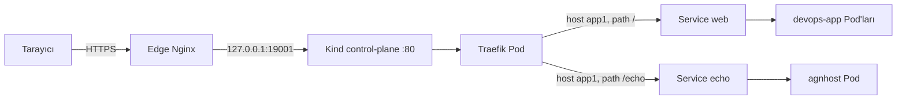
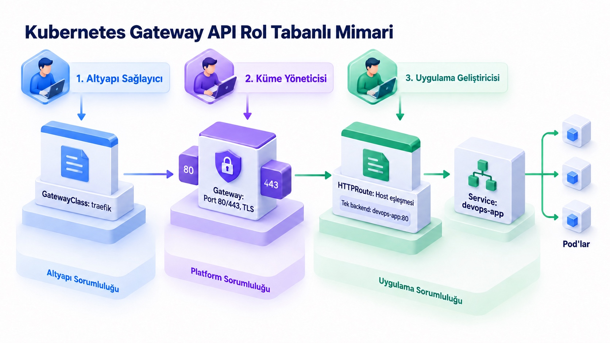

# I01 — Traefik ile Ingress ve Gateway API

| Profil / Araçlar | Açık Portlar |
|---|---|
| `helm`, `kubectl`, Traefik chart `42.4.0` (Traefik v3.7), Gateway API `v1.6.3`, `devops-app`, `agnhost:2.61` | 19001, 19002 (Edge Nginx üzerinden HTTPS) |

## Amaç

- Traefik'i Ingress Controller olarak kurmak.
- Alan adı ve yola göre yönlendiren Ingress yazmak.
- İsteğe bağlı: aynı yönlendirmeyi Gateway API'ye taşımak.

## Ön Koşullar

- Beginner lablar tamamlanmış olmalıdır. `devops-app:1.0` imajı Kind'e yüklü değilse 1. adımda yüklenir.
- Cluster `kind-cluster.yaml` ile oluşturulmuş olmalıdır: control-plane node'unun 80 portu sunucunun `19001`, `19002`, `19003` portlarına eşlenir.
- Sunucudaki Edge Nginx `https://<sunucu-adı>-app1.devopsatolyesi.com` adresini `19001`'e, `-app2` adresini `19002`'ye iletir.

## Mimari ve Çalışma Modeli

Service tek bir uygulamayı açar. Ingress ise tek giriş noktasından gelen HTTP isteklerini alan adı ve yola göre birden fazla Service'e dağıtır. Ingress nesnesi yalnızca bir kuraldır; kuralı uygulayan bir **Ingress Controller** gerekir. Bu labda controller Traefik'tir.



**Gateway API**, Ingress'in yerini alan yeni standarttır ve sorumlulukları ayırır:

{width=60%}

| Nesne | Kim yönetir | Görevi |
|---|---|---|
| GatewayClass | Altyapı ekibi | Hangi controller'ın çalışacağı (`traefik`) |
| Gateway | Platform ekibi | Dinleyici: port, protokol, hangi namespace'lerin rota ekleyebileceği |
| HTTPRoute | Uygulama ekibi | Alan adı, yol, başlık eşleştirmesi ve hedef Service'ler (ağırlıklı dağıtım dahil) |

Traefik hem Ingress hem Gateway API kurallarını okuyabildiği için geçiş aynı controller üzerinde, kesintisiz yapılır.

## Adım Adım Uygulama Rehberi

### 1. Uygulamaları Başlatma

```bash
cd ~/k8s-labs/intermediate/lab-i01-ingress-gateway-traefik
```

`devops-app` imajını derleyip Kind'e yükleyin. B07'de yüklediyseniz komutlar hızlıca tamamlanır:

```bash
docker build -t devops-app:1.0 ~/k8s-labs/app/devops-app
```

```bash
kind load docker-image devops-app:1.0 --name k8s-labs
```

```bash
kubectl create namespace i01-ingress
```

`web` (devops-app) ve `echo` (gönderilen mesajı geri döndüren test uygulaması) adlı iki Service:

```bash
kubectl apply -f starter/apps.yaml -n i01-ingress
```

```bash
kubectl rollout status deployment/web deployment/echo -n i01-ingress --timeout=180s
```

### 2. Traefik'i Kurma

Traefik hem Ingress hem Gateway API kurallarını okuyacak şekilde kurulur. Gateway API nesne türleri (CRD) Kubernetes'le birlikte gelmez; Traefik'ten önce cluster'a eklenir. Sürüm, Traefik 3.7'nin desteklediği Gateway API sürümüyle uyumludur:

```bash
kubectl apply --server-side -f https://github.com/kubernetes-sigs/gateway-api/releases/download/v1.6.3/standard-install.yaml
```

```bash
cat starter/traefik-values.yaml
```

Traefik control-plane node'una yerleşir ve node'un 80 portunu (`hostPort`) dinler:

```bash
helm repo add traefik https://traefik.github.io/charts
```

```bash
helm repo update traefik
```

```bash
helm upgrade --install traefik traefik/traefik \
  --version 42.4.0 \
  --namespace traefik --create-namespace \
  --values starter/traefik-values.yaml \
  --wait --timeout 5m
```

```bash
kubectl get pods -n traefik -o wide
```

Traefik bir IngressClass ve bir GatewayClass oluşturdu. Ingress kuralları `ingressClassName: traefik`, Gateway'ler `gatewayClassName: traefik` ile bu controller'a bağlanır:

```bash
kubectl get ingressclass,gatewayclass
```

Henüz kural olmadığı için her istek `404` döner:

```bash
curl -s -o /dev/null -w '%{http_code}\n' --retry 5 --retry-all-errors --retry-delay 2 http://127.0.0.1:19001/
```

### 3. Ingress Kuralı

Kendi alan adınızı değişkene alın:

```bash
export APP_HOST="$(hostname)-app1.devopsatolyesi.com"
echo "$APP_HOST"
```

Kural `/echo` ile başlayan yolları `echo` Service'ine, geri kalan her şeyi `web` Service'ine gönderir:

```bash
cat starter/ingress.yaml
```

```bash
sed "s|__APP_HOST__|${APP_HOST}|" starter/ingress.yaml | kubectl apply -n i01-ingress -f -
```

```bash
kubectl get ingress -n i01-ingress
```

```bash
kubectl describe ingress web -n i01-ingress
```

### 4. Host Başlığıyla Doğrudan Test

DNS ve HTTPS katmanına girmeden, `Host` başlığıyla Kind'in giriş portunu test edin:

```bash
sleep 3; curl -s -H "Host: ${APP_HOST}" http://127.0.0.1:19001/healthz; echo
```

```bash
curl -s -H "Host: ${APP_HOST}" "http://127.0.0.1:19001/echo?msg=merhaba-ingress"; echo
```

Kurala uymayan bir alan adı `404` alır:

```bash
curl -s -o /dev/null -w '%{http_code}\n' -H "Host: baska.ornek.com" http://127.0.0.1:19001/healthz
```

### 5. Alan Adı ve HTTPS ile Test

Bu test tüm yolu doğrular: DNS, HTTPS, Edge Nginx, Kind, Traefik, Service ve Pod. Tarayıcıdan da açabilirsiniz:

```bash
curl -s "https://${APP_HOST}/healthz"; echo
```

<details><summary><strong>6. İsteğe Bağlı: Gateway API'ye Geçiş</strong></summary>

Traefik, 2. adımda Gateway API kurallarını da okuyacak şekilde kuruldu. Geçiş için yeni nesneleri oluşturmak yeterlidir.

Platform ekibinin Gateway'ini uygulayın. Port `8000`, Traefik'in iç giriş noktasıdır:

```bash
cat starter/gateway.yaml
```

```bash
kubectl apply -f starter/gateway.yaml -n i01-ingress
```

```bash
kubectl wait --for=condition=Programmed gateway/web-gateway -n i01-ingress --timeout=120s
```

**Önizleme:** HTTPRoute'u önce ikinci alan adı (`app2`) için oluşturun. Canlı `app1` trafiği Ingress üzerinden çalışmaya devam eder:

```bash
export PREVIEW_HOST="$(hostname)-app2.devopsatolyesi.com"
```

```bash
sed "s|__ROUTE_HOST__|${PREVIEW_HOST}|" starter/httproute.yaml | kubectl apply -n i01-ingress -f -
```

```bash
kubectl wait --for=jsonpath='{.status.parents[0].conditions[?(@.type=="Accepted")].status}'=True httproute/web -n i01-ingress --timeout=120s
```

```bash
sleep 3; curl -s -H "Host: ${PREVIEW_HOST}" http://127.0.0.1:19002/healthz; echo
```

```bash
curl -s "https://${PREVIEW_HOST}/echo?msg=merhaba-gateway"; echo
```

**Devretme:** Önizleme başarılı. Canlı alan adını HTTPRoute'a ekleyin, ardından eski Ingress'i silin. İki kural kısa bir süre birlikte çalıştığı için kesinti olmaz:

```bash
kubectl patch httproute web -n i01-ingress --type=json -p "[{\"op\":\"add\",\"path\":\"/spec/hostnames/-\",\"value\":\"${APP_HOST}\"}]"
```

```bash
kubectl delete ingress web -n i01-ingress
```

```bash
sleep 3; curl -s "https://${APP_HOST}/healthz"; echo
```

```bash
kubectl get gateway,httproute -n i01-ingress
```

</details>

## Temizlik

```bash
kubectl delete namespace i01-ingress
```

I02 (Dağıtım Stratejileri) Traefik ve Gateway API'yi kullanır; devam edecekseniz Traefik'i kurulu bırakın. Tamamen kaldırmak için:

```bash
helm uninstall traefik -n traefik
```

```bash
kubectl delete namespace traefik
```

```bash
kubectl delete -f https://github.com/kubernetes-sigs/gateway-api/releases/download/v1.6.3/standard-install.yaml --ignore-not-found
```
