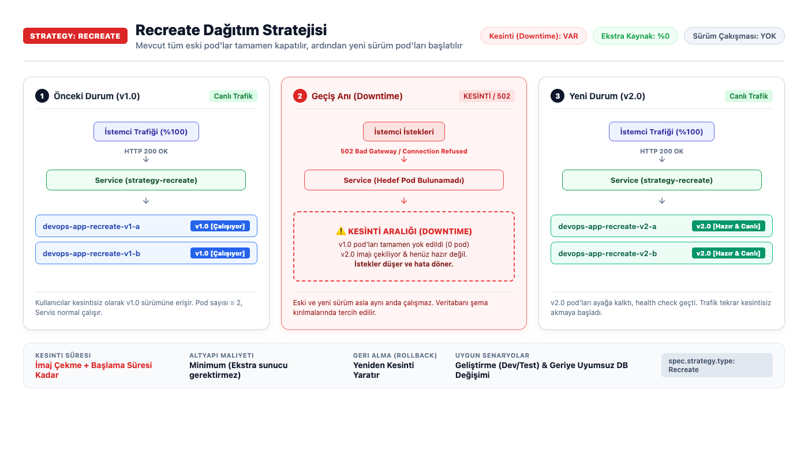
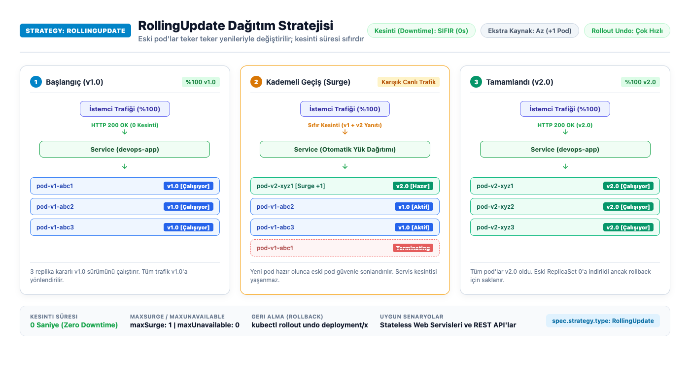
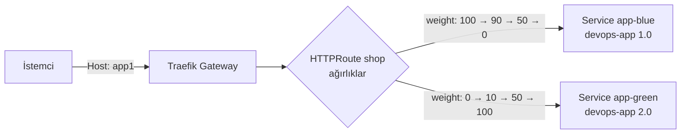

# I02 — Dağıtım Stratejileri: Recreate, RollingUpdate, Blue-Green ve Canary

| Profil / Araçlar | Açık Portlar |
|---|---|
| `kubectl`, `helm`, `docker`, `kind`, Traefik chart `42.4.0`, Gateway API `v1.6.3`, `devops-app` 1.0 ve 2.0 | 19001 (Edge Nginx üzerinden HTTPS) |

## Amaç

- Recreate ve RollingUpdate'te kesintiyi ölçmek.
- HTTPRoute ile Blue-Green geçişi ve geri dönüş yapmak.
- Ağırlıklı ve başlığa göre Canary yapmak.

## Ön Koşullar

- I01'i yaptıysanız temizliği yapılmış olmalıdır: aynı alan adı için başka bir Ingress veya HTTPRoute kalmamalıdır. Kontrol:

  ```text
  kubectl get ingress,httproute -A
  ```

  Gateway API hiç kurulmadıysa bu komut `the server doesn't have a resource type "httproute"` hatası verir; bu normaldir.
- I01'i yapmadıysanız da lab çalışır: Traefik ve Gateway API 4. adımda kurulur.
- Sunucunun `19001` portu (app1 alan adı) bu labda Traefik'e ayrılmıştır; başka bir uygulama kullanmamalıdır. Kontrol:

  ```bash
  curl -s -o /dev/null -w '%{http_code}\n' -m 3 http://127.0.0.1:19001/
  ```

  `000`: port boş, hiçbir controller dinlemiyor (I01 yapılmadıysa beklenen). `404`: I01'den kalan Traefik çalışıyor ama kural yok; bu da uygundur. Başka bir kod ya da bir sayfa geliyorsa app1'i başka bir uygulama kullanıyordur; önce onu kaldırın.
- 2. ve 3. adımda Pod'ları canlı izlemek için ikinci bir terminal açacaksınız (Cockpit'te yeni bir terminal sekmesi ya da ikinci bir SSH oturumu).

## Mimari ve Çalışma Modeli

Stratejiler iki katmanda uygulanır:

| Katman | Strateji | Nasıl |
|---|---|---|
| Deployment | Recreate | Önce tüm eski Pod'lar kapanır, sonra yeniler açılır. Arada kesinti olur. |
| Deployment | RollingUpdate | Pod'lar birer birer değişir; eski ve yeni sürüm kısa süre birlikte cevap verir. |
| Yönlendirme kuralı | Blue-Green | İki sürüm tam kapasiteyle yan yana çalışır; kural tek hamlede eskiden yeniye geçer, geri dönüş de tek hamledir. |
| Yönlendirme kuralı | Canary | Trafiğin küçük bir yüzdesi yeni sürüme verilir, sorun yoksa oran artırılır. |

## Adım Adım Uygulama Rehberi

### 1. İki Uygulama Sürümü

```bash
cd ~/k8s-labs/intermediate/lab-i02-deployment-strategies
```

Aynı koddan iki sürüm derleyin; sürüm numarası uygulamanın cevabında görünür:

```bash
docker build -t devops-app:1.0 ~/k8s-labs/app/devops-app
```

```bash
docker build --build-arg APP_VERSION=2.0 -t devops-app:2.0 ~/k8s-labs/app/devops-app
```

```bash
kind load docker-image devops-app:1.0 devops-app:2.0 --name k8s-labs
```

```bash
kubectl create namespace i02-strategies
```

İstekleri cluster içinden gönderecek test istemcisi:

```bash
kubectl apply -f starter/client.yaml -n i02-strategies
```

### 2. Recreate: Kesintiyi Ölçme

{width=60%}

```bash
cat starter/recreate.yaml
```

```bash
kubectl apply -f starter/recreate.yaml -n i02-strategies
```

```bash
kubectl rollout status deployment/recreate -n i02-strategies --timeout=120s
```

**İkinci terminalde** Pod'ları canlı izleyin ve pencereyi açık bırakın. `-w` (watch) her durum değişikliğini yeni bir satır olarak yazar; çıkmak için `Ctrl+C`:

<!-- runner:skip -->
```bash
kubectl get pods -n i02-strategies -l app=recreate -w
```

**İlk terminalde** devam edin. Arka planda 30 saniye boyunca her yarım saniyede bir istek gönderin. Cevap gelmezse satıra `KESINTI` yazılır:

```bash
kubectl exec client -n i02-strategies -- sh -c 'for i in $(seq 1 60); do wget -qO- -T 1 http://recreate/ 2>/dev/null | grep -o "\"version\":\"[0-9.]*\"" || echo KESINTI; sleep 0.5; done' > recreate.log &
LOOP_PID=$!
```

Döngü çalışırken sürümü güncelleyin:

```bash
kubectl set image deployment/recreate app=devops-app:2.0 -n i02-strategies
```

İkinci terminalde sırayı izleyin: önce iki eski Pod da `Terminating` olur ve kaybolur, ancak ondan sonra yeni Pod'lar `ContainerCreating` → `Running` olur. Arada hiç çalışan Pod yoktur.

```bash
kubectl rollout status deployment/recreate -n i02-strategies --timeout=120s
```

Döngünün bitmesini bekleyip sonuçları sayın:

```bash
wait "$LOOP_PID"; sort recreate.log | uniq -c
```

Eski Pod'lar kapandıktan sonra yeniler hazır olana kadar istekler cevapsız kaldı (`KESINTI`). Recreate, iki sürümün aynı anda çalışamadığı durumlar için (örneğin veritabanı şeması uyumsuzluğu) kullanılır.

### 3. RollingUpdate: Kesintisiz Güncelleme

{width=60%}

```bash
cat starter/rolling.yaml
```

Sıfır kesinti için üç ayar birlikte çalışır:

| Ayar | Görevi |
|---|---|
| `readinessProbe` | Yeni Pod cevap verene kadar trafik almaz |
| `maxUnavailable: 0` | Hazır Pod sayısı güncelleme boyunca hiç düşmez |
| `preStop: sleep 5` | Kapanan Pod, Service onu trafikten çıkarana kadar 5 saniye daha cevap verir |

```bash
kubectl apply -f starter/rolling.yaml -n i02-strategies
```

```bash
kubectl rollout status deployment/rolling -n i02-strategies --timeout=120s
```

İkinci terminaldeki izlemeyi `Ctrl+C` ile durdurun ve bu kez `rolling` Pod'larını izleyin:

<!-- runner:skip -->
```bash
kubectl get pods -n i02-strategies -l app=rolling -w
```

İlk terminalde istek döngüsünü başlatın:

```bash
kubectl exec client -n i02-strategies -- sh -c 'for i in $(seq 1 60); do wget -qO- -T 1 http://rolling/ 2>/dev/null | grep -o "\"version\":\"[0-9.]*\"" || echo KESINTI; sleep 0.5; done' > rolling.log &
LOOP_PID=$!
```

```bash
kubectl set image deployment/rolling app=devops-app:2.0 -n i02-strategies
```

İkinci terminalde farkı izleyin: önce bir yeni Pod açılır ve `1/1` olur, ancak ondan sonra bir eski Pod `Terminating` olur. Bu her Pod için tekrarlanır; hazır Pod sayısı hiç üçün altına düşmez. İş bitince izlemeyi `Ctrl+C` ile durdurun.

```bash
kubectl rollout status deployment/rolling -n i02-strategies --timeout=180s
```

```bash
wait "$LOOP_PID"; sort rolling.log | uniq -c
```

`KESINTI` yok; geçiş sırasında bir süre iki sürüm birlikte cevap verdi. RollingUpdate, Deployment'ın varsayılan stratejisidir.

Hızlı geri dönüş:

```bash
kubectl rollout undo deployment/rolling -n i02-strategies
```

```bash
kubectl rollout status deployment/rolling -n i02-strategies --timeout=180s
```

### 4. Yönlendirme Katmanı: Traefik ve Gateway API

I01'de kurduysanız bu komutlar değişiklik yapmadan tamamlanır:

```bash
kubectl apply --server-side -f https://github.com/kubernetes-sigs/gateway-api/releases/download/v1.6.3/standard-install.yaml
```

```bash
helm repo add traefik https://traefik.github.io/charts
```

```bash
helm upgrade --install traefik traefik/traefik --version 42.4.0 \
  --namespace traefik --create-namespace \
  --values ../lab-i01-ingress-gateway-traefik/starter/traefik-values.yaml \
  --wait --timeout 5m
```

```bash
kubectl get gatewayclass traefik
```

### 5. İki Sürümü Yan Yana Çalıştırma

Blue-Green ve Canary'de iki sürüm ayrı Deployment ve Service olarak çalışır. Hangisinin ne kadar trafik alacağına HTTPRoute içindeki ağırlıklar karar verir:



Blue-Green, ağırlıkların `100/0`'dan `0/100`'e tek seferde değişmesidir. Canary aynı geçişi küçük adımlarla yapar.

```bash
kubectl apply -f starter/blue-green.yaml -n i02-strategies
```

```bash
kubectl rollout status deployment/app-blue deployment/app-green -n i02-strategies --timeout=180s
```

```bash
kubectl apply -f starter/gateway.yaml -n i02-strategies
```

```bash
kubectl wait --for=condition=Programmed gateway/shop-gateway -n i02-strategies --timeout=120s
```

Kural başlangıçta trafiğin tamamını Blue'ya verir:

```bash
export APP_HOST="$(hostname)-app1.devopsatolyesi.com"
```

```bash
cat starter/route-weighted.yaml
```

```bash
sed "s|__APP_HOST__|${APP_HOST}|" starter/route-weighted.yaml | kubectl apply -n i02-strategies -f -
```

```bash
kubectl wait --for=jsonpath='{.status.parents[0].conditions[?(@.type=="Accepted")].status}'=True httproute/shop -n i02-strategies --timeout=120s
```

Yirmi istek gönderip sürümleri sayan yardımcı bir fonksiyon tanımlayın:

```bash
say() { for i in $(seq 1 20); do curl -s -H "Host: ${APP_HOST}" http://127.0.0.1:19001/ | grep -o '"version":"[0-9.]*"'; done | sort | uniq -c; }
```

```bash
say
```

Aynı uygulamaya dışarıdan alan adıyla erişin. İstek Cloudflare'den sunucudaki Nginx'e, oradan `19001` üzerinden Traefik'e gelir. Tarayıcıda açacağınız adres:

```bash
echo "https://${APP_HOST}"
```

Aynı adres `curl` ile:

```bash
curl -s "https://${APP_HOST}/" | grep -o '"version":"[0-9.]*"'
```

Sonraki adımlarda ağırlıkları değiştirdikçe tarayıcıda sayfayı yenileyerek de hangi sürümün cevap verdiğini görebilirsiniz.

### 6. Blue-Green: Tek Hamlede Geçiş ve Geri Dönüş

Green sürümü önceden tam kapasiteyle çalışıyor ve test edilebilir durumda. Trafiği tek hamlede Green'e verin:

```bash
kubectl patch httproute shop -n i02-strategies --type=json -p '[{"op":"replace","path":"/spec/rules/0/backendRefs/0/weight","value":0},{"op":"replace","path":"/spec/rules/0/backendRefs/1/weight","value":100}]'
```

```bash
say
```

Yeni sürümde sorun çıktığını varsayın. Blue hâlâ çalıştığı için geri dönüş aynı hızdadır:

```bash
kubectl patch httproute shop -n i02-strategies --type=json -p '[{"op":"replace","path":"/spec/rules/0/backendRefs/0/weight","value":100},{"op":"replace","path":"/spec/rules/0/backendRefs/1/weight","value":0}]'
```

```bash
say
```

Bedeli: geçiş süresince iki sürüm de tam kapasiteyle çalışır, kaynak iki katına çıkar.

### 7. Canary: Kademeli Geçiş

Trafiğin yüzde 10'unu yeni sürüme verin:

```bash
kubectl patch httproute shop -n i02-strategies --type=json -p '[{"op":"replace","path":"/spec/rules/0/backendRefs/0/weight","value":90},{"op":"replace","path":"/spec/rules/0/backendRefs/1/weight","value":10}]'
```

```bash
say
```

Yirmi istekte oran tam yüzde 10 çıkmayabilir; istek sayısı arttıkça ağırlığa yaklaşır. Hata oranı ve gecikme (A05'te izlenir) iyiyse oranı artırın:

```bash
kubectl patch httproute shop -n i02-strategies --type=json -p '[{"op":"replace","path":"/spec/rules/0/backendRefs/0/weight","value":50},{"op":"replace","path":"/spec/rules/0/backendRefs/1/weight","value":50}]'
```

```bash
say
```

Son adım: yeni sürüm tüm trafiği alır.

```bash
kubectl patch httproute shop -n i02-strategies --type=json -p '[{"op":"replace","path":"/spec/rules/0/backendRefs/0/weight","value":0},{"op":"replace","path":"/spec/rules/0/backendRefs/1/weight","value":100}]'
```

```bash
say
```

### 8. Başlığa Göre Canary

Rastgele kullanıcılar yerine yalnızca belirli istekleri yeni sürüme göndermek için kural, istek başlığına göre ayrılır:

```bash
cat starter/route-header.yaml
```

```bash
sed "s|__APP_HOST__|${APP_HOST}|" starter/route-header.yaml | kubectl apply -n i02-strategies -f -
```

Normal kullanıcı eski sürümü görür:

```bash
curl -s -H "Host: ${APP_HOST}" http://127.0.0.1:19001/; echo
```

`X-Canary: true` başlığı gönderen test kullanıcısı yeni sürümü görür:

```bash
curl -s -H "Host: ${APP_HOST}" -H "X-Canary: true" http://127.0.0.1:19001/; echo
```

Aynı kural gerçek alan adı üzerinden de çalışır. Tarayıcı bu başlığı kendiliğinden göndermediği için tarayıcıda her zaman eski sürüm görünür; başlıklı istek `curl` ile yapılır:

```bash
curl -s -H "X-Canary: true" "https://${APP_HOST}/"; echo
```

## Doğal Doğrulama ve Beklenen Sonuç

```bash
grep -q KESINTI recreate.log && echo "recreate: kesinti oldu" || echo "recreate: kesinti yok"
```

```bash
grep -q KESINTI rolling.log && echo "rolling: kesinti oldu" || echo "rolling: kesinti yok"
```

```bash
curl -s -H "Host: ${APP_HOST}" http://127.0.0.1:19001/ | grep -o '"version":"[0-9.]*"'
```

```bash
curl -s -H "Host: ${APP_HOST}" -H "X-Canary: true" http://127.0.0.1:19001/ | grep -o '"version":"[0-9.]*"'
```

Beklenen sonuç: Recreate kesinti yaşattı, RollingUpdate yaşatmadı; başlık kuralı normal kullanıcıyı eski, test kullanıcısını yeni sürüme gönderiyor.

```text
recreate: kesinti oldu
rolling: kesinti yok
"version":"1.0"
"version":"2.0"
```

## Temizlik

```bash
kubectl delete namespace i02-strategies
```

```bash
rm -f recreate.log rolling.log
```

Traefik ve Gateway API sonraki çalışmalar için kurulu bırakılabilir. Kaldırmak için I01'in temizlik adımlarını uygulayın.
