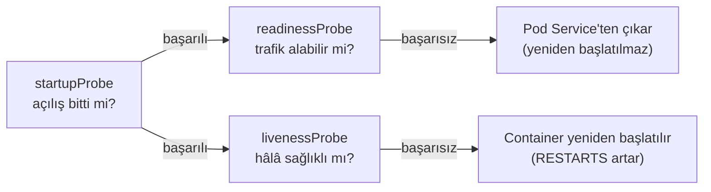

# I03 — Probe'lar ve Kaynak Yönetimi

| Profil / Araçlar | Açık Portlar |
|---|---|
| `kubectl`, `devops-app` (Node.js 24), `busybox:1.37` | — |

## Amaç

- Startup, readiness ve liveness probe farkını görmek.
- Requests, limits ve QoS sınıflarını okumak.

## Ön Koşullar

- I02 tamamlanmış olmalıdır. `devops-app:1.0` imajı Kind'e yüklü değilse 1. adımda yüklenir.

## Mimari ve Çalışma Modeli

Kubelet her container için tanımlanan probe'ları düzenli olarak çalıştırır:



| Probe | Başarısız olursa | Tipik kontrol |
|---|---|---|
| `startupProbe` | Süre dolunca container yeniden başlatılır; o zamana kadar diğer probe'lar çalışmaz | Yavaş açılan uygulamanın hazırlığı |
| `readinessProbe` | Pod `0/1` olur ve Service'ten çıkarılır | Veritabanı bağlantısı, ısınma, geçici yoğunluk |
| `livenessProbe` | Container öldürülüp yeniden başlatılır | Kilitlenme, sonsuz döngü |

Probe üç biçimde yazılır: `httpGet` (HTTP 200-399 başarılı), `tcpSocket` (port açık mı) ve `exec` (komut 0 ile çıkarsa başarılı). Bu labda startup probe uygulamanın `/healthz` adresine bakar. Readiness ve liveness ise elle bozulabilsin diye birer dosya da kontrol eder: dosyayı silmek probe'u başarısız yapar. Readiness ayrıca uygulamanın gerçekten cevap verdiğini doğrular; yalnızca dosyaya bakan bir readiness, uygulama portu dinlemeye başlamadan Pod'u hazır sayardı.

| Kaynak alanı | Anlamı |
|---|---|
| `requests` | Scheduler'ın Pod için node'da ayırdığı garanti kaynak; yerleştirme buna göre yapılır |
| `limits.cpu` | Aşılırsa container yavaşlatılır (throttling), öldürülmez |
| `limits.memory` | Aşılırsa container öldürülür (OOMKilled, B10) |

## Adım Adım Uygulama Rehberi

### 1. Uygulamayı Başlatma

```bash
cd ~/k8s-labs/intermediate/lab-i03-probes-resources
```

```bash
docker build -t devops-app:1.0 ~/k8s-labs/app/devops-app
```

```bash
kind load docker-image devops-app:1.0 --name k8s-labs
```

```bash
kubectl create namespace i03-probes
```

```bash
cat starter/probe-app.yaml
```

```bash
kubectl apply -f starter/probe-app.yaml -n i03-probes
```

### 2. Startup Probe

Uygulama açılışta 15 saniye hazırlık yapar. Bu sürede Pod'lar `Running` ama `0/1` durumundadır; liveness ve readiness henüz çalışmaz:

```bash
sleep 8; kubectl get pods -n i03-probes -l app=probe-app
```

```bash
kubectl rollout status deployment/probe-app -n i03-probes --timeout=120s
```

```bash
kubectl wait --for=condition=Ready pod/client -n i03-probes --timeout=120s
```

Startup probe olmasaydı, açılışı 15 saniye süren uygulama liveness kontrolüne takılıp sürekli yeniden başlatılırdı.

### 3. Readiness: Pod'u Trafikten Çıkarma

Service'e gelen istekler üç Pod'a dağılır:

```bash
for i in 1 2 3 4 5 6; do kubectl exec client -n i03-probes -- wget -qO- http://probe-app/ | grep -o '"pod":"[^"]*"'; done
```

İlk Pod'un readiness kontrolünü bozun:

```bash
POD1=$(kubectl get pods -n i03-probes -l app=probe-app -o jsonpath='{.items[0].metadata.name}')
kubectl exec "$POD1" -n i03-probes -- rm /tmp/ready
```

```bash
kubectl wait --for=condition=Ready=false pod/"$POD1" -n i03-probes --timeout=30s
```

```bash
kubectl get pods -n i03-probes -l app=probe-app
```

Pod çalışmaya devam ediyor ama `0/1`; yeniden başlatılmadı. EndpointSlice'ta hazır değil olarak işaretlendi:

```bash
kubectl get endpointslice -n i03-probes -l kubernetes.io/service-name=probe-app -o jsonpath='{range .items[*].endpoints[*]}{.targetRef.name} ready={.conditions.ready}{"\n"}{end}'
```

Artık isteklerin hiçbiri bu Pod'a gitmez:

```bash
for i in 1 2 3 4 5 6; do kubectl exec client -n i03-probes -- wget -qO- http://probe-app/ | grep -o '"pod":"[^"]*"'; done | sort | uniq -c
```

Kontrolü düzeltin; Pod trafiğe geri döner:

```bash
kubectl exec "$POD1" -n i03-probes -- touch /tmp/ready
```

```bash
kubectl wait --for=condition=Ready pod/"$POD1" -n i03-probes --timeout=30s
```

### 4. Liveness: Container'ı Yeniden Başlatma

İkinci Pod'un liveness kontrolünü bozun:

```bash
POD2=$(kubectl get pods -n i03-probes -l app=probe-app -o jsonpath='{.items[1].metadata.name}')
kubectl exec "$POD2" -n i03-probes -- rm /tmp/alive
```

İki başarısız kontrolden sonra kubelet container'ı öldürür ve yeniden başlatır. Container açılışta dosyaları yeniden oluşturduğu için Pod kendiliğinden düzelir:

```bash
kubectl wait --for=jsonpath='{.status.containerStatuses[0].restartCount}'=1 pod/"$POD2" -n i03-probes --timeout=60s
```

```bash
kubectl describe pod "$POD2" -n i03-probes | grep -i 'liveness probe failed' | head -1
```

```bash
kubectl wait --for=condition=Ready pod/"$POD2" -n i03-probes --timeout=90s
```

```bash
kubectl get pods -n i03-probes -l app=probe-app
```

`RESTARTS` sütunu bu Pod için `1` gösterir. Pod silinmedi, adı aynı; yalnızca içindeki container yeniden başlatıldı.

### 5. Requests, Limits ve Node Kapasitesi

Pod'un kaynak tanımları:

```bash
kubectl get pods -n i03-probes -l app=probe-app -o custom-columns='POD:.metadata.name,CPU_REQ:.spec.containers[0].resources.requests.cpu,MEM_REQ:.spec.containers[0].resources.requests.memory,CPU_LIM:.spec.containers[0].resources.limits.cpu,MEM_LIM:.spec.containers[0].resources.limits.memory'
```

Scheduler, node'daki **requests** toplamına bakar; gerçek kullanıma bakmaz. Bir node'un ayrılmış kaynakları:

```bash
kubectl describe node k8s-labs-worker | grep -A8 'Allocated resources'
```

### 6. QoS Sınıfları

Kubernetes, kaynak tanımlarına göre her Pod'a bir QoS sınıfı verir. Node'da bellek sıkışırsa ilk önce `BestEffort`, en son `Guaranteed` Pod'lar çıkarılır:

```bash
cat starter/qos-pods.yaml
```

```bash
kubectl apply -f starter/qos-pods.yaml -n i03-probes
```

```bash
kubectl get pods -n i03-probes -l demo=qos -o custom-columns='POD:.metadata.name,QOS:.status.qosClass'
```

| Sınıf | Koşul |
|---|---|
| `Guaranteed` | Her container'da CPU ve bellek için `requests` = `limits` |
| `Burstable` | En az bir `requests` veya `limits` var ama Guaranteed değil |
| `BestEffort` | Hiç `requests` veya `limits` yok |

## Temizlik

```bash
kubectl delete namespace i03-probes
```
