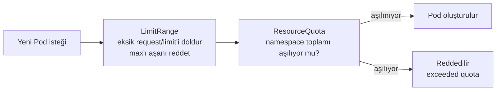

# I04 — ResourceQuota ve LimitRange

| Profil / Araçlar | Açık Portlar |
|---|---|
| `kubectl`, `nginx:1.30-alpine` | — |

## Amaç

- Namespace'e kaynak bütçesi koymak.
- Container'lara varsayılan ve en fazla kaynak değeri vermek.
- Kotayı aşan isteğin nedenini Events'te bulmak.

## Ön Koşullar

- I03 tamamlanmış olmalıdır (requests ve limits kavramları).

## Mimari ve Çalışma Modeli

Paylaşılan bir cluster'da bir ekibin tüm kaynakları tüketmesini engellemek için namespace'e kurallar konur. İki nesne Pod oluşturulurken API sunucusunda (admission) devreye girer:



| Nesne | Kapsam | Bu labdaki değerler |
|---|---|---|
| LimitRange | Her container | Varsayılan request `100m / 64Mi`, varsayılan limit `200m / 128Mi`, en fazla `1 CPU / 512Mi` |
| ResourceQuota | Namespace toplamı | En fazla 4 Pod; request toplamı `500m / 512Mi`; limit toplamı `1 CPU / 1Gi` |

Namespace'te CPU veya bellek kotası varsa her Pod'un request ve limit yazması zorunludur. LimitRange'in varsayılan değerleri bu zorunluluğu karşılar.

## Adım Adım Uygulama Rehberi

### 1. Namespace ve Kurallar

```bash
cd ~/k8s-labs/intermediate/lab-i04-resourcequota-limitrange
```

```bash
kubectl create namespace i04-quota
```

```bash
cat starter/limitrange.yaml starter/resourcequota.yaml
```

```bash
kubectl apply -f starter/limitrange.yaml -f starter/resourcequota.yaml -n i04-quota
```

```bash
kubectl describe limitrange container-limits -n i04-quota
```

```bash
kubectl describe resourcequota team-quota -n i04-quota
```

### 2. Kaynak Yazmayan Pod: Varsayılanlar Eklenir

```bash
cat starter/no-resources-pod.yaml
```

```bash
kubectl apply -f starter/no-resources-pod.yaml -n i04-quota
```

Manifestte `resources` alanı yoktu; LimitRange değerleri ekledi:

```bash
kubectl get pod no-resources -n i04-quota -o jsonpath='{.spec.containers[0].resources}{"\n"}'
```

### 3. Üst Sınırı Aşan Pod: Hemen Reddedilir

Pod 2 CPU istiyor; LimitRange bir container için en fazla 1 CPU'ya izin veriyor:

```bash
kubectl apply -f starter/too-big-pod.yaml -n i04-quota || echo "Pod reddedildi"
```

Hata API sunucusundan gelir (`Forbidden`), Pod hiç oluşturulmaz.

### 4. Kotayı Aşan Deployment: Eksik Pod

Deployment 5 replica istiyor; namespace'te en fazla 4 Pod olabilir ve biri zaten çalışıyor:

```bash
kubectl apply -f starter/web-deployment.yaml -n i04-quota
```

```bash
sleep 5; kubectl get deployment web -n i04-quota
```

`READY` sütunu `3/5` gösterir. Deployment komutu hata vermedi; Pod'ları oluşturamayan ReplicaSet'tir. Nedeni ReplicaSet'in olaylarındadır:

```bash
kubectl describe replicaset -n i04-quota -l app=web | grep -i 'exceeded quota' | tail -1
```

Kullanılan ve izin verilen değerler:

```bash
kubectl describe resourcequota team-quota -n i04-quota
```

### 5. Kotaya Uydurma

Ya kota artırılır ya da ihtiyaç kotaya uydurulur. Tek başına çalışan Pod'u silin ve Deployment'ı 4 replica'ya indirin:

```bash
kubectl delete pod no-resources -n i04-quota
```

```bash
kubectl scale deployment web --replicas=4 -n i04-quota
```

```bash
kubectl rollout status deployment/web -n i04-quota --timeout=120s
```

## Temizlik

```bash
kubectl delete namespace i04-quota
```
