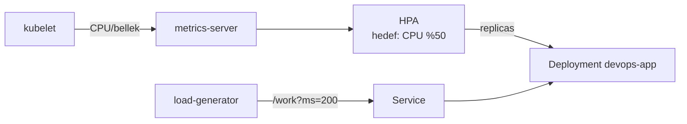

# I05 — HPA ile Otomatik Ölçekleme ve DaemonSet

| Profil / Araçlar | Açık Portlar |
|---|---|
| `kubectl`, metrics-server `v0.9.1`, `devops-app`, `busybox:1.37` | — |

## Amaç

- metrics-server ile kaynak kullanımını okumak.
- HPA ile CPU'ya göre otomatik ölçeklemek.
- DaemonSet ile her node'da Pod çalıştırmak.

## Ön Koşullar

- I03 tamamlanmış olmalıdır (requests kavramı). `devops-app:1.0` imajı Kind'e yüklü değilse 1. adımda yüklenir.

## Mimari ve Çalışma Modeli



HPA yaklaşık 15 saniyede bir ölçüm yapar ve gereken Pod sayısını şöyle hesaplar:

```text
istenen = ceil( mevcut Pod sayısı x mevcut ortalama kullanım / hedef kullanım )
```

Kullanım yüzdesi Pod'un **CPU request**'ine göre hesaplanır; request yazılmamış Pod'lar için HPA çalışmaz. Küçülme, ani dalgalanmalarda Pod'ların gidip gelmemesi için bir bekleme süresinden (`stabilizationWindowSeconds`) sonra yapılır.

**DaemonSet**, her uygun node'da tam bir Pod çalıştırır. Yeni node eklenince Pod kendiliğinden oraya da açılır. Log toplayıcı, metrik ajanı ve ağ eklentisi gibi node başına çalışması gereken bileşenler için kullanılır.

## Adım Adım Uygulama Rehberi

### 1. metrics-server Kurulumu

```bash
cd ~/k8s-labs/intermediate/lab-i05-hpa-daemonset
```

```bash
kubectl apply -f https://github.com/kubernetes-sigs/metrics-server/releases/download/v0.9.1/components.yaml
```

Kind node'larının kubelet sertifikası cluster içi bir CA ile imzalı değildir. Eğitim ortamı için metrics-server'a bu doğrulamayı atlamasını söyleyin:

```bash
cat starter/metrics-server-kind-patch.json
```

```bash
kubectl patch deployment metrics-server -n kube-system --type=json --patch-file starter/metrics-server-kind-patch.json
```

```bash
kubectl rollout status deployment/metrics-server -n kube-system --timeout=180s
```

İlk ölçümlerin toplanması yaklaşık bir dakika sürer:

```bash
timeout 120 sh -c 'until kubectl top nodes >/dev/null 2>&1; do sleep 5; done'; kubectl top nodes
```

### 2. Uygulama ve HPA

```bash
docker build -t devops-app:1.0 ~/k8s-labs/app/devops-app
```

```bash
kind load docker-image devops-app:1.0 --name k8s-labs
```

```bash
kubectl create namespace i05-scale
```

```bash
kubectl apply -f starter/app.yaml -n i05-scale
```

```bash
kubectl rollout status deployment/devops-app -n i05-scale --timeout=120s
```

```bash
cat starter/hpa.yaml
```

```bash
kubectl apply -f starter/hpa.yaml -n i05-scale
```

HPA ilk ölçümü alınca `TARGETS` sütunu `cpu: 1%/50%` gibi bir değer gösterir:

```bash
timeout 120 sh -c 'until kubectl get hpa devops-app -n i05-scale -o jsonpath="{.status.currentMetrics[0].resource.current.averageUtilization}" | grep -q .; do sleep 5; done'; kubectl get hpa devops-app -n i05-scale
```

### 3. Yük Altında Büyüme

```bash
kubectl apply -f starter/load-generator.yaml -n i05-scale
```

Canlı izlemek isterseniz ikinci bir terminalde `kubectl get hpa,pods -n i05-scale -w` çalıştırın. HPA'nın Pod sayısını artırmasını bekleyin:

```bash
timeout 240 sh -c 'until [ "$(kubectl get hpa devops-app -n i05-scale -o jsonpath={.status.desiredReplicas})" -ge 3 ]; do sleep 10; done'
```

```bash
kubectl get hpa devops-app -n i05-scale
```

```bash
kubectl top pods -n i05-scale
```

HPA'nın kararlarını olaylardan okuyun:

```bash
kubectl describe hpa devops-app -n i05-scale | grep -i 'New size' | tail -3
```

### 4. Yük Kalkınca Küçülme

```bash
kubectl delete pod load-generator -n i05-scale
```

CPU düşer; bekleme süresinden sonra HPA Pod sayısını en aza indirir. Bu birkaç dakika sürebilir:

```bash
timeout 360 sh -c 'until [ "$(kubectl get deployment devops-app -n i05-scale -o jsonpath={.spec.replicas})" -eq 1 ]; do sleep 10; done'
```

```bash
kubectl get hpa,deployment -n i05-scale
```

### 5. DaemonSet

Cluster'ın kendi bileşenleri de DaemonSet ile çalışır; her node'da bir `kube-proxy` ve bir `kindnet` Pod'u vardır:

```bash
kubectl get daemonset -n kube-system
```

Her node'a bir ajan yerleştirin:

```bash
cat starter/daemonset.yaml
```

```bash
kubectl apply -f starter/daemonset.yaml -n i05-scale
```

```bash
kubectl rollout status daemonset/node-agent -n i05-scale --timeout=120s
```

```bash
kubectl get pods -n i05-scale -l app=node-agent -o wide
```

Her Pod farklı bir node'da çalışır. Toleration sayesinde control-plane node'u da dahildir:

```bash
kubectl logs -n i05-scale -l app=node-agent
```

## Temizlik

```bash
kubectl delete namespace i05-scale
```

metrics-server, A05'te ve `kubectl top` komutlarında kullanılmaya devam edebilir; kaldırmak için:

```bash
kubectl delete -f https://github.com/kubernetes-sigs/metrics-server/releases/download/v0.9.1/components.yaml
```
