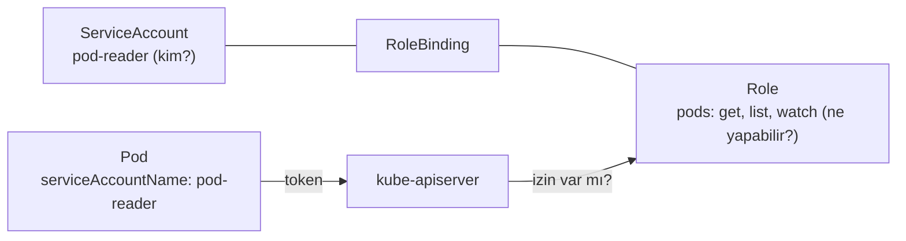

# I06 — RBAC ve securityContext

| Profil / Araçlar | Açık Portlar |
|---|---|
| `kubectl`, `curlimages/curl:8.17.0`, `busybox:1.37`, `nginx:1.30-alpine` | — |

## Amaç

- ServiceAccount, Role ve RoleBinding ile en az yetki vermek.
- Yetkiyi Pod içinden API'ye istek atarak doğrulamak.
- securityContext ve Pod Security Admission ile container'ı kısıtlamak.

## Ön Koşullar

- I05 tamamlanmış olmalıdır.

## Mimari ve Çalışma Modeli



| Nesne | Kapsam | Görevi |
|---|---|---|
| ServiceAccount | Namespace | Pod'ların ve otomasyonun kimliği |
| Role / ClusterRole | Namespace / tüm cluster | İzin listesi: hangi kaynak, hangi fiil (`get`, `list`, `create`, `delete` ...) |
| RoleBinding / ClusterRoleBinding | Namespace / tüm cluster | Kimliği izin listesine bağlar |

RBAC yalnızca izin verir; izin verilmeyen her şey yasaktır. Her Pod'a ServiceAccount token'ı `/var/run/secrets/kubernetes.io/serviceaccount/` altına bağlanır.

securityContext, container'ın Linux üzerindeki yetkilerini sınırlar: hangi kullanıcıyla çalıştığı, dosya sistemine yazıp yazamayacağı ve hangi kernel yetkilerine (capabilities) sahip olduğu. **Pod Security Admission** ise bir namespace için bu ayarları zorunlu kılar; kurala uymayan Pod oluşturulmadan reddedilir.

## Adım Adım Uygulama Rehberi

### 1. Kimlik ve İzinler

```bash
cd ~/k8s-labs/intermediate/lab-i06-rbac-securitycontext
```

```bash
kubectl create namespace i06-security
```

```bash
cat starter/rbac.yaml
```

```bash
kubectl apply -f starter/rbac.yaml -n i06-security
```

```bash
kubectl get serviceaccount,role,rolebinding -n i06-security
```

### 2. Yetkiyi Sorgulama

`--as`, komutu başka bir kimlik adına dener. ServiceAccount kimliğinin biçimi `system:serviceaccount:<namespace>:<ad>` şeklindedir:

```bash
kubectl auth can-i list pods -n i06-security --as=system:serviceaccount:i06-security:pod-reader
```

```bash
kubectl auth can-i delete pods -n i06-security --as=system:serviceaccount:i06-security:pod-reader
```

```bash
kubectl auth can-i get secrets -n i06-security --as=system:serviceaccount:i06-security:pod-reader
```

Role yalnızca kendi namespace'inde geçerlidir:

```bash
kubectl auth can-i list pods -n default --as=system:serviceaccount:i06-security:pod-reader
```

Kimliğin bu namespace'teki bütün izinleri:

```bash
kubectl auth can-i --list -n i06-security --as=system:serviceaccount:i06-security:pod-reader | head -12
```

### 3. Pod İçinden API'ye Gerçek İstek

Bu Pod `pod-reader` kimliğiyle çalışır:

```bash
kubectl apply -f starter/api-client.yaml -n i06-security
```

```bash
kubectl wait --for=condition=Ready pod/api-client -n i06-security --timeout=120s
```

Pod'a bağlanan token, CA sertifikası ve namespace dosyaları:

```bash
kubectl exec api-client -n i06-security -- ls /var/run/secrets/kubernetes.io/serviceaccount/
```

İzinli istek: bu namespace'teki Pod'ların adlarını API'den okuyun:

```bash
kubectl exec api-client -n i06-security -- sh -c 'SA=/var/run/secrets/kubernetes.io/serviceaccount; curl -s --cacert $SA/ca.crt -H "Authorization: Bearer $(cat $SA/token)" https://kubernetes.default.svc/api/v1/namespaces/i06-security/pods' | grep -o '"name": "api-client"' | head -1
```

İzinsiz istek: Secret listesi `403 Forbidden` döner:

```bash
kubectl exec api-client -n i06-security -- sh -c 'SA=/var/run/secrets/kubernetes.io/serviceaccount; curl -s -o /dev/null -w "%{http_code}\n" --cacert $SA/ca.crt -H "Authorization: Bearer $(cat $SA/token)" https://kubernetes.default.svc/api/v1/namespaces/i06-security/secrets'
```

### 4. Varsayılan Container Yetkileri

securityContext yazılmamış bir container root kullanıcıyla çalışır ve dosya sistemine yazabilir:

```bash
kubectl apply -f starter/default-pod.yaml -n i06-security
```

```bash
kubectl wait --for=condition=Ready pod/default-pod -n i06-security --timeout=120s
```

```bash
kubectl exec default-pod -n i06-security -- id
```

```bash
kubectl exec default-pod -n i06-security -- sh -c 'echo test > /etc/yazilabilir && echo "kok dosya sistemine yazildi"'
```

### 5. Sıkılaştırılmış Container

```bash
cat starter/secure-pod.yaml
```

```bash
kubectl apply -f starter/secure-pod.yaml -n i06-security
```

```bash
kubectl wait --for=condition=Ready pod/secure-pod -n i06-security --timeout=120s
```

Container root olmayan kullanıcıyla çalışır:

```bash
kubectl exec secure-pod -n i06-security -- id
```

Kök dosya sistemine yazılamaz; yalnızca bağlanan `/tmp` yazılabilir:

```bash
kubectl exec secure-pod -n i06-security -- sh -c 'echo test > /etc/yazilabilir' || echo "yazma engellendi"
```

```bash
kubectl exec secure-pod -n i06-security -- sh -c 'echo test > /tmp/gecici && echo "/tmp yazilabilir"'
```

Bir saldırgan container'a girse bile sistem dosyalarını değiştiremez, yetki yükseltemez.

### 6. runAsNonRoot ve Root İmajı

`runAsNonRoot: true` yazılı ama imaj root ile çalışacak şekilde hazırlanmışsa kubelet container'ı başlatmaz:

```bash
kubectl apply -f starter/root-image-pod.yaml -n i06-security
```

```bash
sleep 10; kubectl get pod root-image -n i06-security
```

```bash
kubectl describe pod root-image -n i06-security | grep -i 'runAsNonRoot' | head -1
```

Çözüm, root gerektirmeyen bir imaj kullanmak veya `runAsUser` ile kullanıcı vermektir. Bu Pod'u silin:

```bash
kubectl delete pod root-image -n i06-security
```

### 7. Pod Security Admission

Namespace'e `restricted` güvenlik seviyesini zorunlu kılan etiketi ekleyin:

```bash
kubectl label namespace i06-security pod-security.kubernetes.io/enforce=restricted
```

Komut, kurala uymayan mevcut Pod'lar için uyarı verir. Mevcut Pod'lar silinmez; kural yalnızca yeni oluşturulan Pod'lara uygulanır. Varsayılan ayarlarla yeni bir Pod oluşturmayı deneyin:

```bash
kubectl run psa-test --image=busybox:1.37 -n i06-security -- sleep 60 2>&1 | head -2 || true
```

Hata mesajı eksik ayarları tek tek sayar (`allowPrivilegeEscalation`, `capabilities`, `runAsNonRoot`, `seccompProfile`). Sıkılaştırılmış Pod ise kurala uyar:

```bash
kubectl delete pod secure-pod -n i06-security
```

```bash
kubectl apply -f starter/secure-pod.yaml -n i06-security
```

```bash
kubectl wait --for=condition=Ready pod/secure-pod -n i06-security --timeout=120s
```

## Temizlik

```bash
kubectl delete namespace i06-security
```
